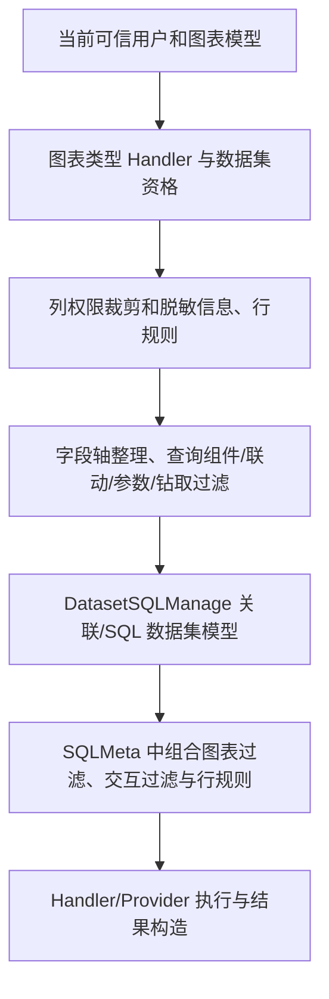

# DataEase 核心链路深读：查询、交互、发布与导出

日期：2026-10-16。承接 [全功能地图](DataEase全功能地图与架构学习记录.md)。本轮从功能目录进一步追踪实现，不新增 BI 业务功能、不运行参考项目构建、不调用写接口。

用户已明确暂时没有企业测试环境或已授权 X-Pack 源码，先研究现有内容；企业实现缺口保留，不再把补齐它作为当前社区源码研究的前置条件。

## 1. 本轮结论

1. 发布边界涵盖文档、图表、联动、跳转、外部参数等一组配置，不能只对布局 JSON 做版本控制。
2. 查询组件包含运行状态；默认值、当前值、清空、重置和级联父值为空有不同语义。容器、Tab、弹窗区都会影响条件收集。
3. 模板图表的示例结果与真实查询是不同分支。模板显示正常不证明数据集替换和计算正确。
4. 数据集编辑预览与受权限约束的消费预览并非天然同一入口，调用参数和主体上下文必须一起核对。
5. 分享不是普通用户会话的另一种 URL；链接身份需要验证资源、发布态、接口和素材范围。
6. 导出执行与下载是两个独立阶段，均有身份与生命周期；线程上下文必须显式传递并清理。
7. 参考项目存在社区替补权限实现；不能把该模式用于我们若依多用户 BI 的默认授权。

以下结论来自本地源码阅读，不是对运行实例的漏洞结论或全链路测试通过声明。

## 2. 图表查询与数据模型

### 2.1 实际处理顺序

`ChartDataServer.getData` 先区分 TEMPLATE 示例结果与真实查询。真实图表解码后进入 `ChartDataManage.calcData`：

阅读位置：`ChartDataManage.java:157` 入口；约 207 行列权限和行规则；约 370 行钻取；约 445 行图表过滤；约 459 行关联 SQL；约 485 行 SQLMeta 条件组合；约 503 行结果计算。源码可能后续变动，以方法名定位为准。

不是所有环节都能归结为“给 SQL 末尾加 WHERE”。关联、聚合、计算字段和时间钻取决定了条件所在层级；我们应保留已实现的结构化参数化查询，按新模型专门扩展编译器。

### 2.2 表模型、SQL 模型和文件/API 模型

`DatasetSQLManage.getUnionSQLForEdit` 同时组织关联树、选择字段、数据源别名映射和参数值。`getUnionTable` 区分：

- 物理表：产生表名/schema/别名模型；
- SQL 节点：解码 SQL，经过 Provider 注释处理和 SQL 变量解析，收集待绑定值，再嵌入子查询；
- 文件/API 对应引擎表：检查物理表属于当前数据源。

跨源与非跨源选择不同 Provider。`invalidCrossDs` 常量虽然包含 Doris 等类型，本轮搜索仅发现声明，**不能据此断言 Doris 不支持跨源**；需实际执行路径和目标方言验证。这是阅读代码时应避免的推断。

### 2.3 预览不是一种统一权限语义

`DatasetDataManage.previewDataWithLimit(..., checkPermission, ...)` 中列权限和行规则的执行取决于 `checkPermission`。`DatasetDataServer.previewData` 传入 false；其他保存数据/消费入口还各有资格检查与策略处理。因此“使用同一个 Manage 方法”不能证明所有预览都执行相同行列规则。

这不直接构成越权结论：还需检查调用者是否具有模型编辑资格、接口拦截器以及扩展实现。本项目应显式区分编辑建模与受限消费，避免复用一个不清晰的布尔开关来决定整个权限边界。

## 3. 查询组件、联动和钻取

### 3.1 查询组件状态与容器

前端 `hooks/web/useFilter.ts:158` 从主画布、Group、Tab 等结构收集 VQuery，结合 popupAvailable 与位置决定参与查询的组件。首次加载会使用默认值，后续查询使用当前值；数字范围还需要保留 0，不能按布尔真假判断其是否为空。

`v-query/cascade-utils.ts` 区分配置态 selectValue 与运行态 currentSelectValue。父条件 undefined/null/空字符串/空数组均作为空处理；数字 0 不属于这组空值。

后续自主实现应至少定义：

| 状态/动作 | 应明确的行为 |
|---|---|
| 首次打开 | 哪些默认值生效，默认值缺失时是否查询 |
| 修改尚未应用 | 输入状态与已生效条件分开 |
| 清空 | 移除当前选择，不能偷偷恢复默认值 |
| 重置 | 按产品约定恢复默认值，是否立即查询需明确 |
| 父条件变化 | 何时清除子选项、重取候选，是否暂停子组件查询 |
| 隐藏或切换 Tab | 是否保留值、是否仍参与过滤，不能靠 DOM 是否挂载偶然决定 |
| 请求乱序 | 旧的候选值/查询响应不得覆盖新条件 |

### 3.2 联动绑定

`LinkageSet.vue` 收集画布中的图表，区分同数据集与不同数据集；为来源和目标配置字段映射。`VisualizationLinkageService.saveLinkage` 写入 snapshot 关系与字段表，并排除来源图表到自身的映射；查询根据 resourceTable 选择草稿或发布关系。

我们不需要照搬其分表实现，但发布时必须固定允许的来源、目标、字段类型和操作。消费者不能提交一个任意 targetField 或替换整个查询。权限注解/全局拦截需要沿契约和宿主完整确认，不能因服务方法中未内联检查就直接判定放行。

### 3.3 钻取与外部参数

前端图表的 chartClick 累加维度路径，drillJump 截断路径并重新查询。后端在 `calcData` 中以路径条件约束数据、加入下一层维度；时间维度可转成区间。钻取必须与其他过滤并存，返回上级不能丢掉数据权限或其他控件条件。

外部参数由 `VisualizationOuterParamsService` 管理参数定义与目标绑定；保存到 snapshot，发布查询读取 core。参数具有稳定标识、名称、目标类型和关联字段，不能只存一个无类型字典。编码传输不代替验证。

## 4. 发布、恢复和编辑历史

`DataVisualizationServer.updatePublishStatus` 发布时调用 `CoreVisualizationManage.dvRestore`，后者从 snapshot 复制图表，并先清理再复制 LinkJump、Linkage、OuterParams 等发布关系，防止旧绑定残留。

`dvSnapshotRecover` 的方向相反：从 core 恢复编辑稿，包括文档、图表和关系。它是恢复到当前发布内容，不能被描述为任意历史时间点回滚。

另一个重要细节：`findById` 收到 main-edit 时可能调用 `dvSnapshotRecover` 建立编辑镜像。因此，**打开编辑页面也可能写入镜像数据**，不能笼统把所有 GET/详情读取或界面浏览称为零持久化副作用。

前端 `snapshot.ts` 的撤销/重做包含组件、样式、图表、交互和部分文档状态；恢复时保留当前文档身份等稳定值。撤销后再操作会截断 redo 分支。编辑命令/快照历史和服务器发布副本应分别建模、分别验收。

## 5. 模板示例与实例化

`VisualizationTemplateExtendDataManage.getChartDataInfo` 从扩展记录读取示例图表结果并赋给当前图表；不是访问业务数据源计算。

`decompression` 在生成新图表 ID、重写引用后，将普通模板 tableId 清空并标为 TEMPLATE；应用模板还有 appData 分支。模板替换数据集要同时处理字段、排序、过滤、计算、联动和参数引用，不是只更换 datasetId。

已确认解析阶段会预写扩展记录及保存素材。本项目模板应设计“暂存→完成实例化→归属转移/取消过期回收”，不能在研究或预览阶段无提示创建业务连接、表或授权。

## 6. 分享与导出

### 6.1 分享身份

`LinkTokenValidationManage.verify` 先用未验证 shareId 查找记录，再验证 Token 和分享策略，最后建立 LinkIdentity；未验签的 claim 不是可信身份。

`checkRequestPath` 限制链接可访问的路径/方法；`DeLinkAop` 限制发布态、资源 ID、图表归属和数据集一致性，子资源还检查它确实嵌入父资源。静态素材需要属于该画布，不能因登录成功就任意读取服务器文件。

这些是本地现有实现的已读控制点，不代表所有请求覆盖已经审计。我们未来分享入口应保持单独身份契约，不把分享者用户 ID 直接当成若依会话。

### 6.2 导出执行与下载

`ExportCenterDownLoadManage.startDatasetTask` 将用户、代理组织及 IP 上下文显式传入线程，finally 清理；不能依赖线程池自动携带请求身份。执行还会重新读取数据集、字段等资源状态。

`ExportCenterManage.retry` 限定当前用户任务和 FAILED 状态，重置后按资源类型重试。`generateDownloadUri` 核验任务归属并生成带时效的下载凭据；下载验证是与执行分开的环节。

未来我们的策略还需明确：排队后撤权、导出执行中撤权、文件生成后撤权和链接过期分别如何处理。本轮仅阅读到具体控制点，没有证明参考系统在这些时间窗口全部拒绝正确。

## 7. 社区与企业权限边界

`CorePermissionManage.checkAuth` 带 `@XpackInteract(...replace=true)`，本体返回 true，真实扩展可替换；行列 API 也为可选注入。社区实例能成功查询，不能证明企业角色合并/继承的实际行为。

本项目已有若依可信身份、功能码与 BI ACL/行列策略，应继续默认拒绝未经授权访问；不引入参考项目用于社区单用户的替补放行行为。用户已说明目前没有企业材料，这部分只记录未知，不阻塞现有核心学习。

## 8. 后续验证场景清单（本轮未执行）

以下是从源码行为提炼的待验证案例，不是测试通过记录。涉及持久化的操作只使用登记的隔离测试资源，不覆盖现有示例和用户数据。

| 场景 | 期望检查 |
|---|---|
| 两图表单选/多选筛选 | 查询/清空/重置含义一致，0/空串/空数组边界明确 |
| 父子级联 | 父条件变化或清空不保留非法子值，候选响应乱序不回填旧值 |
| 容器/Tab/弹窗 | 可见性、活动页签与过滤有效范围符合设计 |
| 同/跨数据集联动 | 字段类型映射有效，清除后保留其他过滤；伪造目标字段被拒绝 |
| 时间钻取与上钻 | 区间、排序、路径及其他筛选同时正确 |
| 草稿改交互而未发布 | 消费仍使用原发布绑定；再次发布去掉已经删除的映射 |
| 恢复发布稿 | 布局、图表、主题、参数和交互一起恢复，资源身份不变 |
| 模板替换数据集 | 示例如实标识；缺失/类型错误字段阻止无效发布，引用全部重映射 |
| 编辑/消费预览 | 功能资格、资源 ACL 和数据策略符合各自上下文 |
| 分享伪造 resourceTable 或图表 ID | 无法访问草稿、别的资源或不相关素材 |
| 导出排队/重试/下载 | 主体、权限变化、任务归属、过期及上下文清理分别验证 |
| 单表与关联计算 | 行规则在聚合前生效，脱敏/隐藏字段不从过滤、排序或枚举泄漏 |

已有 `tests/visualization-read-security`、`tests/excel-file-access` 等目录提供相应历史回归说明；本轮只阅读，不重跑或沿用其历史通过数字作新结论。尤其“有测试代码”不等于本次已执行测试。

## 9. 源码定位和后续研究

本轮重点文件（相对 `D:/bi-tools/dataease`）：

- `core/core-backend/src/main/java/io/dataease/chart/manage/ChartDataManage.java`
- `core/core-backend/src/main/java/io/dataease/dataset/manage/{DatasetSQLManage,DatasetDataManage}.java`
- `core/core-backend/src/main/java/io/dataease/visualization/server/{VisualizationLinkageService,VisualizationOuterParamsService,DataVisualizationServer}.java`
- `core/core-backend/src/main/java/io/dataease/visualization/manage/{CoreVisualizationManage,VisualizationTemplateExtendDataManage}.java`
- `core/core-backend/src/main/java/io/dataease/share/manage/LinkTokenValidationManage.java`、`share/interceptor/DeLinkAop.java`
- `core/core-backend/src/main/java/io/dataease/exportCenter/manage/{ExportCenterManage,ExportCenterDownLoadManage}.java`
- `core/core-backend/src/main/java/io/dataease/system/manage/CorePermissionManage.java`
- `core/core-frontend/src/hooks/web/useFilter.ts`、`custom-component/v-query/cascade-utils.ts`
- `core/core-frontend/src/components/visualization/LinkageSet.vue`、`views/chart/components/views/index.vue`
- `core/core-frontend/src/store/modules/data-visualization/snapshot.ts`

## 10. 追加深读：刷新、布局与复杂计算

### 10.1 定时刷新不是简单增加 setInterval

已读 `hooks/web/useChartRefreshTimer.ts` 和图表 `views/index.vue` 的 queryData/calcData：

- 计时器根据预览模式和启用状态建立；离开相应状态或组件卸载时清理。
- 图表自己的刷新开启时，会忽略外部整体刷新通知，减少双重触发。
- queryData 有约 300ms 合并触发和 loading 门闩，正在查询时不重复提交；自动刷新复用上次已生效的请求条件。
- 单图刷新回调包含清除本图来源联动的逻辑。这是产品语义，应明确决策后采用，不能假定刷新必须清空所有筛选。
- 该计时器工具本身没有实现浏览器隐藏时降频或全页面全局并发预算；不能因存在定时器清理就宣称后台页、跨组件并发和异常恢复全部解决。

我们现有看板已有两路并发和响应代次丢弃机制；将来新增定时刷新应扩展它，不另外启动不受控的组件轮询。候选值、图表请求和手工刷新也应明确优先级。

### 10.2 大屏缩放和仪表板重排要分开

已读 `components/data-visualization/canvas/DePreview.vue:190` 起的样式计算。参考实现对 keep、widthFirst、heightFirst、keepProportion 使用不同尺寸、比例和 transform 处理，并区分仪表板与大屏预览。

因此自主实现至少区分：设计坐标、编辑缩放、预览视口适配和导出尺寸。编辑器缩小到 60% 不应将原组件的设计坐标改为 60%；等比缩放也不等于窄屏单列重排。后续要验证鼠标命中、字体、图表重绘、图片/PDF 导出与坐标精度。

### 10.3 同环比和透视表不只是前端换一种图

已读 `YoyChartHandler.calcChartResult`：处理对比计算时，可能先扩展取数范围，再恢复原筛选查询，并按维度对齐当前展示结果。时间范围、缺失对比期、排序以及权限条件必须在多个查询中保持一致。

`TablePivotHandler` 还会计算自定义汇总并可能为辅助数据发起附加查询。一个组件不一定只对应一条 SQL，不能只以组件数估算数据库压力。我们未来需要对额外计算的查询次数、行数和时限一起预算。

## 11. 本轮收敛结果

已将“功能入口已知”推进到查询/交互/发布/模板/分享/导出/撤销/刷新/布局与部分复杂计算的具体调用链；其中关键实现与本项目当前消费路径作了对照。引用的方法和控制点来自本轮阅读，既有仓库回归说明没有被当作本轮执行结果。

尚未完成的是受控业务场景的运行矩阵、全部图表和方言组合，以及缺失企业实现。后续运行验证优先使用已登记的隔离资源，不能在官方示例上保存联动、发布或执行真实外发。用户目前无需补充其他材料；功能开发继续暂停。
