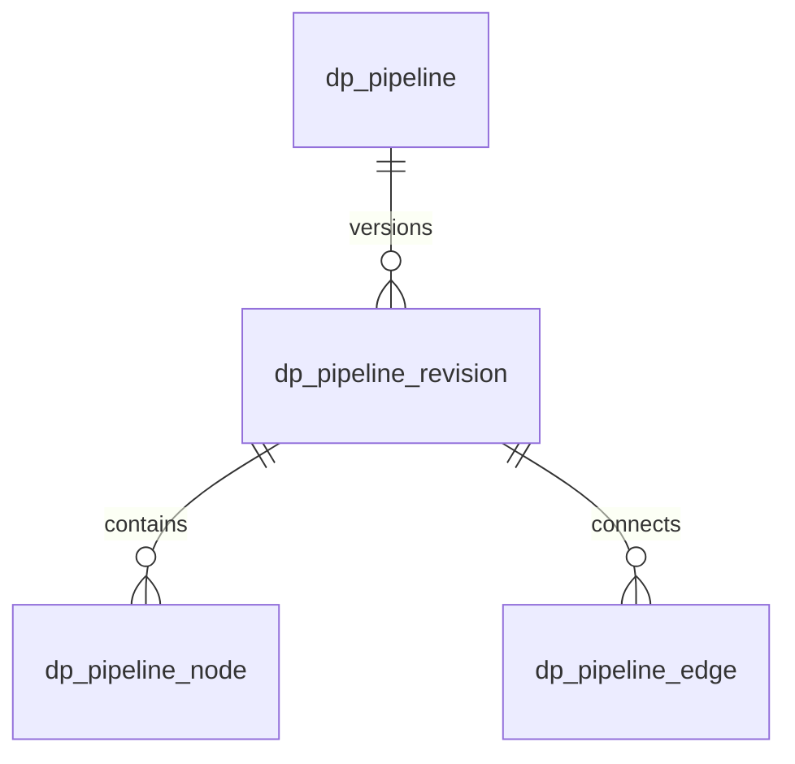

# 数据加工流程定义与运行预览

V34 为 DP-018 增加流程、不可变修订、节点和连线结构。V35 为 DP-020 增加流程运行和节点运行事实。V36 为 DP-021 增加当前生效修订指针、草稿乐观锁字段、回滚来源标记和发布历史。当前运行器只提供受限的只读样本预览，用于检查来源、关联、筛选和转换结果；不等同于生产作业调度，也不执行数仓物化。

## 定义结构

- `dp_pipeline` 是有稳定 `pipeline_code` 的逻辑流程和名称。
- `dp_pipeline_revision` 是一个可编辑草稿或已发布的不可变版本；输入/输出 schema、参数和 SHA-256 定义哈希都按修订保存。
- `dp_pipeline_node` 保存节点类型、节点配置、输入/输出 schema 和画布坐标。
- `dp_pipeline_edge` 以 revision 内的稳定 `node_key` 保存端口间连接，支持显式连线类型和多输入顺序。

节点和连线外键绑定 revision，无法跨版本引用。唯一键在一个 revision 内约束节点 key 和连线重复。发布后的不可变约束由服务端状态校验执行，不能只依靠 UI 禁用编辑。节点配置按节点类型白名单校验，禁止把任意 SQL、连接凭据或秘密直接存入通用 JSON。

## 已接入的定义 API

- `GET /bi/pipeline`：只返回当前操作者拥有查看权限的流水线。
- `POST /bi/pipeline`：创建逻辑流水线并建立首个草稿版本。
- `GET /bi/pipeline/{id}`：读取版本、节点、连线。
- `PUT /bi/pipeline/{pipelineId}/revisions/{revisionId}`：保存草稿 DAG 并执行静态校验。
- `POST /bi/pipeline/{pipelineId}/revisions/{revisionId}/copy`：从已有版本复制出新的草稿。
- `POST /bi/pipeline/{pipelineId}/revisions/{revisionId}/publish`：重新校验并发布定义哈希。
- `GET /bi/pipeline/{pipelineId}/revisions/{fromRevisionId}/diff/{toRevisionId}`：比较两个修订的节点增删改、连线变动和流程参数/结构变更。
- `POST /bi/pipeline/{pipelineId}/revisions/{revisionId}/rollback`：从历史已发布修订复制出新的回滚草稿，不会直接改变线上生效版本。
- `GET /bi/pipeline/{pipelineId}/publish-history?limit=30`：查询发布/回滚操作、前后版本、操作人及时间。

端点分别要求 `bi:pipeline:list`、`bi:pipeline:add`、`bi:pipeline:edit`、`bi:pipeline:publish` 功能权限，并继续校验流水线和来源数据集资源权限。运行预览和取消另要求 `bi:pipeline:run`。将 `ruoyi-modules/ruoyi-bi/deploy/ruoyi-menu.sql` 应用到若依系统库后，超级管理员可分配上述权限；脚本不会自动授予普通业务角色。

当前节点类型配置白名单：`SOURCE_DATASET(datasetId, alias)`、`JOIN(joinType, leftKeys, rightKeys, relationship)`、`FILTER(conditions)`、`TRANSFORM(mappings)`、`QUALITY_GATE(ruleSetDatasetId, ruleSetId, minPassRate, severity)`、`WAREHOUSE_PUBLISH(layer, modelCode, writeMode, partitionField)`。`writeMode` 生产 Maps 路径支持 `REPLACE`（暂存后 EXCHANGE/RENAME）与 `APPEND`（已存在则 `INSERT…SELECT` 追加；首写同 REPLACE 建表）；`UPSERT` 仅静态白名单占位，运行时拒绝。`SOURCE_DATASET`：预览走 `DatasetService.preview`（1～100 行）；生产走 `boundedExtract`（上限与 `ClickHouseBatchPublisher.MAX_BATCH_ROWS` 对齐，默认生产行数受 `bi.pipeline.production-max-rows` 约束）。静态校验覆盖引用数据集查看和查询权限、必需来源和输出、来源没有输入、JOIN 两路输入与字段类型兼容、字段映射/过滤字段存在、受限字段约束、非来源节点必须有输入、发布节点必须是终点、孤儿、重复连线、自环、环路、目标层限制及凭证/SQL字段拦截。质量门禁只允许选择同数据集已发布的规则集；规则字段必须存在于上游 schema 且不受限，并至少配置一条满足严重级别阈值的启用规则。功能权限与资源权限双重校验。生产提交经 `TaskPoolGate` 校验 `PIPELINE` 泳道暂停与软并发。

基础画布 UI、字段名映射和静态类型推导已经实现。当前推导针对数据集字段元数据及字段级 DENY/MASK 策略；自动迁移后的实时源结构变更处理仍归 DP-025/026。定义保存与发布不执行节点；预览仅在已发布修订上运行，且重新解析执行人的有效身份和来源权限。

## 版本与执行边界

修订状态使用 `DRAFT`、`PUBLISHED`、`RETIRED`。发布流程检查输入引用权限、目标仓库层、节点配置、必需输入、孤儿节点、环路和至少一个可达输出。每次执行必须固定一个已发布 `revision_id` 和 definition hash，DP-020 的运行事实不可引用可变草稿。

## DP-020 运行预览 MVP

- `POST /bi/pipeline/{pipelineId}/revisions/{revisionId}/runs/preview`：提交已发布修订的样本预览，必填幂等 `requestKey`，超时范围 10～120 秒。
- `GET /bi/pipeline/{pipelineId}/runs?limit=30`：按流水线查看最近运行；`GET /bi/pipeline/runs/{runId}` 返回节点状态；`POST /bi/pipeline/runs/{runId}/cancel` 取消排队或运行中的预览。
- V35 保存固定修订/hash、运行人、Trace ID、状态、耗时和每节点行数/摘要。运行状态包括 `PENDING`、`RUNNING`、`SUCCEEDED`、`FAILED`、`CANCELLED`、`TIMED_OUT`。
- 服务端使用单 worker、有界队列和每流程最多一个活跃运行；来源节点调用现有数据集预览 API，最多 100 行；JOIN、FILTER 和字段映射 TRANSFORM 在内存中操作预览样本。运行器不持久化行样本，节点明细只保存行数和字段数。
- `QUALITY_GATE` 从所选数据集的已发布规则集读取规则，在当前流入样本上执行 `NOT_NULL`、`UNIQUE`、`NULL_RATE_MAX`。门禁摘要仅保留计数、通过率、规则编码和截断标记，不持久化原始样本；未达最低通过率时节点失败，后续节点跳过。当前来源最多 100 行，因此这是样本门禁，不能代表全量质量扫描。
- `WAREHOUSE_PUBLISH` 当前只生成预览摘要，明确报告 `warehouseWrites=0`。当前预览没有数仓写入副作用。
- 运行明细在数据加工页面轮询运行态并展示状态、耗时和逐节点结果；菜单脚本定义独立 `bi:pipeline:run` 功能权限。接口仍验证流水线资源权限，执行开始时重新验证操作者身份和运行能力。

## DP-021 发布保护与回滚

- `dp_pipeline.current_revision_id` 指向当前生效版本。发布操作在一个事务内更新修订状态、比较当前指针、切换指针并写入 `dp_pipeline_publish_history`；指针发生并发变化时事务失败，旧版本继续生效。
- 草稿保存使用 `lock_version` 乐观锁。客户端必须带上读取时的 `expectedVersion`；每次成功保存递增版本。过期页面的保存或发布会得到冲突提示，数据库事务回滚节点/连线替换。
- 版本差异按稳定节点 key 比较节点类型/配置/schema/画布位置、连线以及输入输出结构/流程参数/备注；对比读取受流水线查看授权保护。
- 回滚 API 只允许从已发布版本复制新的不可变来源标记草稿，并要求独立 `bi:pipeline:rollback` 功能权限和资源回滚/编辑权限。操作者应检查差异并运行 DP-020 只读样本预览，再单独执行发布；回滚发布也会新增历史记录并将内容写入一个新的修订号。
- 普通发布使用 `bi:pipeline:publish` 权限；历史对比/查询使用 `bi:pipeline:list`。更新 `ruoyi-menu.sql` 后，管理员可把回滚权限按职责分配给角色。

现有历史修订仍保留 `PUBLISHED`，`current_revision_id` 才表示当前实际生效版本。V36 会将已有流程中版本号最新的已发布修订回填为当前生效版本；迁移以前的发布事件没有历史明细，审计只从 V36 后开始完整记录。

## 当前限制和后续验收

流程遗留运行巡检每 60 秒执行一次（`bi.pipeline.recovery-delay-ms` 可配置）。数据库中的 `PENDING/RUNNING` 运行从创建时间起超过自身超时预算加 60 秒宽限期后，会通过条件更新收束为 `TIMED_OUT`，释放活跃流程占位，并关闭未完成节点。当前实例仍持有执行线程时同时请求中断；其他实例或重启后的遗留运行只收束持久化状态。巡检不自动重放流程，不将未知执行结果记为成功；仍需验证重启和超时场景。

这是单实例只读预览 MVP，不支持重试、进程崩溃恢复、多实例任务认领、持久化消息队列、生产指标告警或任意规模数据处理。数据库查询超时取决于数据集服务自身的限制；取消通过中断执行线程请求停止，不能保证强制终止所有 JDBC 驱动调用。质量门禁当前只扫描最多 100 行预览样本，规则类型限于 `NOT_NULL`、`UNIQUE`、`NULL_RATE_MAX`；全量扫描、更多规则算子与可复用执行计划仍待开发。仍需在本地应用对应迁移、重启服务，并用已授权的真实发布流程验收幂等、权限、门禁失败后下游跳过、取消与超时。真实数仓写入、调度和分区回补分别归 DP-039/022，不包含在当前预览范围。
