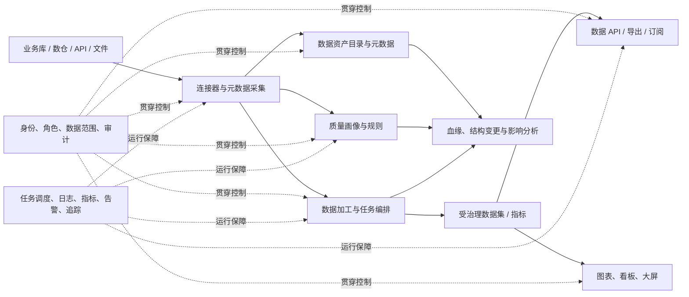
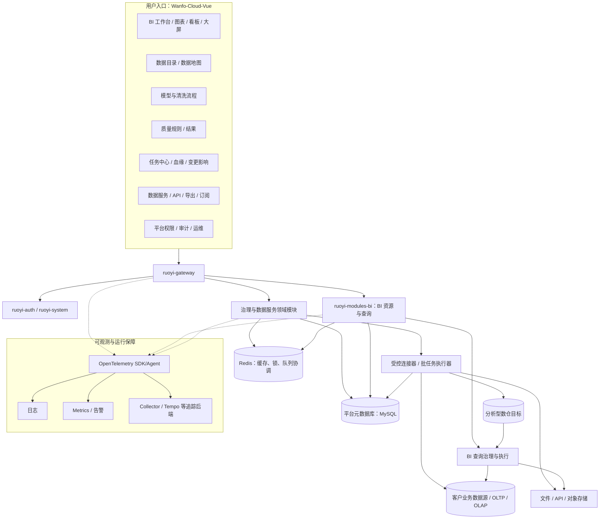

# Wanfo 数据平台系统架构设计

> 版本：1.0  
> 日期：2026-10-26  
> 状态：目标架构与分阶段实施基线  
> 适用范围：以 `wanfo-bi-cloud` 为基础，将现有 BI 报表系统逐步扩展为覆盖数据接入、加工、治理、服务和分析消费的一体化数据平台。

**产品定位与底座宪章（优先阅读）**：[PRODUCT-POSITIONING-AND-FOUNDATION.md](PRODUCT-POSITIONING-AND-FOUNDATION.md)。与本文冲突时，以定位文档的产品边界与底座约束为准，再回修本文。  
**实现级功能原理回溯（业务流 / 数据流 / 核心表 / 服务入口）**：[SYSTEM-DESIGN.md](SYSTEM-DESIGN.md)。目标架构叙述与实现细节冲突时，以代码 + SYSTEM-DESIGN 为准回修本文。

配套文档：[数据平台功能清单与验收标准](DATA-PLATFORM-FUNCTION-CHECKLIST.md)、[开发任务清单](DATA-PLATFORM-TASK-LIST.md)、[开发计划](DATA-PLATFORM-DEVELOPMENT-PLAN.md)、[现有表结构与引用盘点](DATA-PLATFORM-SCHEMA-INVENTORY.md)、[第一阶段实施设计](DATA-PLATFORM-PHASE1-DESIGN.md)。

## 1. 设计摘要

目标不是另起炉灶重写 BI，也不是一次性引入数据湖、消息中间件和大量微服务，而是在现有平台上补齐数据资产、数据质量、加工编排、变更安全、治理和数据服务能力。

设计原则：

1. **复用现有资产**：沿用 RuoYi 的登录、组织、角色、菜单、审计、网关和部署机制；沿用现有 BI 数据源、数据集、查询权限和图表看板模型。
2. **治理围绕资产**：数据源、表、字段、数据集、指标、API、图表和看板都能被发现、理解、授权、追溯和运维。
3. **控制面与数据执行面分离**：平台元数据、规则和任务定义存放于平台库；连接器通过受控执行服务访问源库；长时间扫描和加工走异步任务，不阻塞管理请求。
4. **先可用、后分布式**：第一阶段以清晰模块边界和单实例可运行作为目标；只有在负载、隔离或独立扩缩容需要时才拆执行 Worker/微服务。
5. **权限服务端闭环**：无论从 BI、数据 API、导出还是质量任务读取数据，都必须使用服务端身份、数据范围和数据源授权；不能信任浏览器传入的用户/组织/数据范围。
6. **安全默认开启**：凭据不回传、不写普通日志；外部 URL 受服务端白名单控制；自定义 SQL、表达式、Webhook 与导出均有边界、审计和资源限制。
7. **兼容演进**：新模块引用已有 BI 资源 ID/稳定 URN，不复制 BI 数据源和图表事实；数据模型变更先预览依赖影响，再迁移并留回滚点。

## 2. 参考项目调研与借鉴边界

调研对象为本机 `D:\zhengliang\zl-base-cloud`、`D:\zhengliang\zl-bi-front`，以及当前仓库的功能清单与代码结构。参考内容是架构和功能形态，不代表它们与当前平台使用同一套认证、数据库或组件，也不代表每个参考功能都已通过本项目验收。

| 参考来源 | 已看到的模块/页面 | 对 Wanfo 的借鉴点 | 不建议直接照搬的部分 |
|---|---|---|---|
| `zl-base-cloud/zl-modules/zl-governance` | 元数据采集与查询、数据质量规则/任务/结果、血缘、元数据变更事件、任务 DAG、审计与告警 | 将目录、质量、血缘、变更和任务治理组织为明确领域；规则有模板、执行记录和结果详情；采集结果可形成元数据快照 | `org.dromara` 模块代码、Sa-Token 权限与当前 RuoYi 登录/权限上下文不兼容；不能把治理工程写入 BI 表的做法视为可接受集成方式 |
| `zl-base-cloud/zl-modules/zl-data-api` | API 定义、API Key、调用日志、导出任务、订阅 | 数据服务需要独立的访问凭据、调用审计、限流、异步导出与订阅生命周期 | 不复制其鉴权实现和密钥存储；必须复用 Wanfo 网关/权限，并单独评估公开 API 的威胁模型 |
| `zl-base-cloud/zl-modules/zl-bi-report` | 数据源、数据集、指标、图表、看板、目录、行列权限、查询审计 | BI 资源需要稳定标识、明确数据口径与可追溯引用 | 当前仓库已自行演进 BI 功能；不应再引入第二套 BI 资产表和查询执行器 |
| `zl-bi-front/src/pages/governance` | 元数据采集、数据地图、质量规则/结果/看板、血缘、结构变更、列权限、作业、查询审计、搜索 | 治理功能应以“发现—理解—校验—追溯—处理”为用户工作流，而不是散落在配置表单里 | React/Ant Design 页面不能直接移植到当前 Vue 3/Element Plus；优先借鉴导航、筛选、详情抽屉和任务状态交互 |
| `zl-bi-front/src/pages/dataService` | API 管理、Key、调用日志、导出、订阅 | 平台应提供安全可控的数据复用出口 | 不因参考项目有独立页就默认开放匿名 API；先采用登录/授权访问，开放式调用另行评审 |
| 当前仓库 `docs/PLATFORM-EXTENSION-ROADMAP.md` | API/文件增强、清洗建模、质量、图表、分析算法、订阅能力与边界 | 作为当前功能状态和下一步待办的基线，文档里的 `[x]` 不等于生产 SLA 或外部通道已验收 | 不能把规划文档中的边界、限制和未验收项从新架构说明中省略 |

### 2.1 对照当前系统能力

以当前代码和 `docs/PLATFORM-EXTENSION-ROADMAP.md` 为准：

- **已有基础**：RuoYi 登录/角色/菜单、网关、审计与监控；BI 数据源、数据集、字段、图表、看板、大屏；数据源连接器与多数据库支持；查询权限/行列规则、查询并发/超时/取消/慢查询治理；全量质量扫描；多表关联、字段公式、清洗步骤与只读回放；API OAuth 授权码 + PKCE 及对象数组展开；文件导入、结构变更预览；新图表、地图、预测和订阅相关能力。
- **仍需平台化**：跨资源的数据资产目录、元数据周期采集/字段画像、端到端血缘与变更影响工作台、可运营的质量任务生命周期、可视化加工 DAG、生产级任务运行控制和告警、结构变更安全迁移/回滚、指标口径的统一管理、可控的数据服务目录与全局审计。
- **验收注意**：实现了功能接口不等于已在生产数据源、集群部署、企业微信/SMTP 或高负载环境完成端到端验证。连接器、外部通知、时区和多实例执行需按实际部署单独验收。

## 3. 愿景、目标和非目标

### 3.1 平台愿景

让数据使用者能找到可信数据、理解业务口径、申请并获得授权、复用受治理的数据集/指标/API；让数据工程和管理人员能接入、处理、校验、追踪并安全发布数据。

### 3.2 第一阶段目标

- 形成统一数据资产身份和目录，覆盖数据源、库表字段、BI 数据集、指标、图表/看板与数据 API。
- 打通“数据源/数据集 → 元数据采集 → 质量规则/任务 → 运行结果 → 血缘/影响分析 → BI 使用”的基本闭环。
- 将清洗和关系建模提升为可版本化、可调度、可观测、可安全回放的任务流程。
- 文件/API/源表结构变化时识别依赖并给出迁移计划；失败能够回滚平台发布版本，不对源业务数据做不可逆写入。
- 提供受权限约束的数据服务出口，支持审计、限流、分页、异步导出和密钥轮换。
- 统一任务、查询、审计和告警视图，便于日常运维定位问题。
- 建立最小批处理数仓闭环：分析型目标存储与业务/平台库分离，接入至少一个业务源，支持全量与增量同步、分层建模、物化和源目标对账，并让一组 BI 消费切到数仓。

### 3.3 非目标

- 不替换企业级数仓/湖仓或建设通用湖仓产品；本项目需要建设受控的分析存储和最小批处理数仓能力，服务平台自己的治理与 BI 闭环。
- 不直接把任意 SQL、Groovy、脚本作为默认的数据加工方式；默认使用类型化、可验证的节点和受限表达式。
- 不替代企业主数据、数据仓库、流计算、专业调度系统或企业级 IAM。
- 不在没有数据量、并发和 SLA 依据时预先引入 Kafka、Kubernetes、独立查询引擎或复杂微服务拆分。
- 不默认允许匿名外网访问数据 API，也不将数据库凭据暴露到浏览器。

## 4. 目标能力全景



平台至少应有以下相互协作的能力层：

1. **连接与接入**：关系型库、OLAP、API、文件连接和元数据采集；连接测试、凭据管理、只读建议、分页/增量参数。
2. **资产目录**：数据源、库/schema、表、字段、数据集、指标、API 和 BI 作品的统一搜索、分类、说明、负责人、敏感级别、标签和状态。
3. **数据加工**：多表模型、清洗转换、质量门禁、依赖 DAG、运行版本、回放、错误重试和发布。
4. **可信与治理**：画像、质量规则、质量分、血缘、结构变更、影响评估、指标口径、权限审批、审计和数据生命周期。
5. **服务与消费**：SQL/数据集查询、BI 报表、大屏、指标服务、受控 API、导出和订阅。
6. **平台运维**：任务/查询/连接监控、日志、Trace、告警、资源配额、数据保留和备份恢复。

## 5. 总体架构

### 5.1 逻辑架构图



“治理与数据服务领域模块”是逻辑边界，不要求第一阶段立即成为独立微服务。建议第一阶段在当前 RuoYi 后端仓库中建立独立业务模块/包边界；待任务资源隔离、独立部署或扩容有实际需求后，再把执行 Worker 独立进程化。`ruoyi-modules-bi` 继续负责现有 BI 资源和查询执行，不再造一套图表/数据集体系。

### 5.2 控制面与执行面

| 平面 | 负责内容 | 允许的操作 | 主要约束 |
|---|---|---|---|
| 控制面 | 数据源登记、目录元数据、模型/流程定义、质量规则、权限、API 定义、审计 | 读写平台元数据库；创建/暂停/发布任务 | 请求短时完成；凭据加密；所有写操作留审计；租户/组织范围在服务端校验 |
| 执行面 | 元数据采集、质量扫描、数据刷新、清洗回放、订阅生成、导出和数据 API 查询 | 通过连接器访问经授权的数据源；读源数据；向目标存储写入时仅写入明确配置的目标 | 异步、幂等、限额、超时、可取消、可重试；最小凭据；不在日志写 SQL 参数和数据内容 |

平台数据库、客户业务数据库与分析型数仓目标职责分离：平台库保存配置、目录快照、运行元信息、审计；客户源库承载原始业务数据；分析型目标承载受控入仓和物化结果。数仓目标必须显式配置，不能将业务明细或加工结果写入平台元数据库。

### 5.3 进程与模块边界

**阶段一建议**：

- `ruoyi-gateway`：统一入口、认证上下文传递、路由、限流边界。
- `ruoyi-auth` / `ruoyi-system`：沿用账号、组织、角色、菜单和操作日志。
- `ruoyi-modules-bi`：保留并维护 `Datasource / Dataset / Field / Chart / Dashboard / Screen` 的所有权，提供稳定的内部只读资产/授权接口。
- 新建治理领域边界（可先与 BI 共用一个部署单元）：`catalog`、`metadata`、`lineage`、`quality`、`pipeline`、`schema-change`、`data-service`、`audit`。每个领域拥有自己的 Controller/Service/Mapper 和表前缀，不直接跨领域修改表。
- `ruoyi-job`：初期可复用现有调度机制触发治理任务；治理任务仍由业务服务创建 `run` 记录和执行状态。确认任务并发/资源隔离压力后，将执行器拆成 `data-platform-worker`，控制服务仍保留任务定义与权限。
- 前端以现有 Vue 3 + TypeScript + Element Plus 为底座，BI 和数据平台共享导航、数据源选择、权限提示、任务状态组件。

### 5.4 服务拆分触发条件

满足下列任意情况再考虑独立治理/执行服务，而非以“模块多”为拆分理由：

- 质量扫描/文件解析任务会影响 BI 在线查询的 CPU、内存或连接池；需要分离资源池或单独扩容。
- 任务执行需要隔离运行账号、网络、磁盘或依赖环境。
- 执行器需要不同发布节奏、维护窗口或高可用策略。
- 同一租户的任务需被调度到指定 Worker/数据区域。
- 单体数据库事务和发布节奏已形成明确瓶颈，并有压测/故障数据支持拆分。

拆分后仍通过内部 API/事件契约访问 BI 资产；不得由治理服务直接更新 `bi_*` 核心业务表。

## 6. 领域模型与数据所有权

以下是逻辑实体清单，不是最终 DDL。实施前应对照现有 `bi_*` 表、Flyway 迁移和 RuoYi 主表做重复校验，再分版本新增迁移。

| 领域 | 核心实体（建议前缀 `dp_` 或独立 schema） | 关键关系与责任 |
|---|---|---|
| 数据源 | `dp_source_ref`（可只引用 BI `datasource_id`）、`dp_connector_capability` | 不复制密码；源连接归 BI/凭据服务所有；治理侧只保存受控引用和采集状态 |
| 资产目录 | `dp_asset`、`dp_asset_column`、`dp_asset_version`、`dp_asset_tag`、`dp_asset_owner` | 统一 URN；资产类型为 source/database/table/column/dataset/metric/chart/dashboard/api 等；来源 ID、名称、层级、业务说明、负责人、敏感级别 |
| 元数据采集 | `dp_scan_definition`、`dp_scan_run`、`dp_scan_issue` | 采集范围、周期、游标/版本、任务状态、错误摘要；运行记录与资产快照关联 |
| 数据画像 | `dp_profile_run`、`dp_profile_column_stat` | 行数、空值率、基数、最小/最大值等聚合统计；敏感字段按策略脱敏；统计结果需要标明采集时间与是否全量 |
| 血缘 | `dp_lineage_edge`、`dp_lineage_snapshot` | from/to asset URN、粒度（table/column）、edge type、来源（SQL解析/流程配置/人工确认）、置信度、有效版本 |
| 数据质量 | `dp_dq_rule`、`dp_dq_task`、`dp_dq_run`、`dp_dq_result`、`dp_dq_result_sample` | 规则版本化；任务绑定资产/规则组；执行结果保留口径、扫描范围、耗时和失败原因；样例默认限量、脱敏 |
| 加工流程 | `dp_pipeline`、`dp_pipeline_revision`、`dp_pipeline_node`、`dp_pipeline_edge`、`dp_pipeline_run`、`dp_pipeline_node_run` | 流程草稿/发布版分离；节点依赖、输入输出 schema、参数版本和每节点运行状态可追溯 |
| 结构变更 | `dp_schema_change`、`dp_impact_ref`、`dp_migration_plan`、`dp_migration_step` | 保存前后快照和受影响资源；计划确认后迁移；失败回滚平台引用/版本并记录不可自动修复的人工动作 |
| 指标 | `dp_metric`、`dp_metric_revision`、`dp_metric_dimension` | 名称、业务定义、SQL/表达式引用、单位、粒度、时区、口径负责人、版本和审批状态；执行授权沿用数据集/数据源权限 |
| 数据服务 | `dp_api_definition`、`dp_api_revision`、`dp_api_key`、`dp_api_call_log`、`dp_export_run`、`dp_subscription` | API Key 仅存哈希、权限范围、过期和轮换状态；调用日志不留密钥与结果明细；导出/订阅是异步任务 |
| 审计与通知 | `dp_audit_event`、`dp_alert_delivery` | 记录操作者、对象、动作、结果、请求追踪 ID；凭据/内容/隐私数据不进入审计正文；通知重试有幂等键 |

### 6.1 统一资产 URN

推荐稳定格式示例：

```text
wanfo://source/{sourceId}
wanfo://source/{sourceId}/database/{database}/table/{table}
wanfo://source/{sourceId}/database/{database}/table/{table}/column/{column}
wanfo://dataset/{datasetId}/field/{fieldId}
wanfo://metric/{metricId}
wanfo://chart/{chartId}
wanfo://dashboard/{dashboardId}
wanfo://api/{apiId}
```

URN 以不可变 ID/版本为主，名称只用于展示；库名、表名和字段名须按数据源类型转义和规范化。血缘和引用关系不以中文显示名称作为主键。对于源表改名，需要用旧/新 URN 与迁移计划显式连接，不静默改写全部历史。

### 6.2 资产目录信息分层

- **技术元数据**：数据源类型、库/schema、对象名、字段名/类型/注释、主外键、更新时间、大小/行数（可得时）。
- **业务元数据**：业务名称、定义、负责人、业务域、标签、使用说明、可信等级、指标口径。
- **治理元数据**：敏感级别、权限标签、质量状态、血缘、数据保留策略、结构变更状态。
- **运行元数据**：最后成功采集/加工/质量检查时间、运行耗时、近期开销、错误摘要、数据新鲜度。

所有计算型信息需要标记采集时间、来源、版本和完整性，不把推断信息伪装成用户确认事实。

## 7. 关键业务链路

### 7.1 接入数据源与目录采集

1. 有权限的管理员在现有数据源管理页登记连接配置；秘密仅后端加密存储，连接测试用只读/限时凭据。
2. 用户选择数据库/schema/table 范围并创建采集任务，配置频率、排除规则和负责人。
3. 执行器在独立事务/连接池中拉取元数据，不默认拉取业务行；必要的画像扫描必须单独授权。
4. 采集完成后生成不可变快照，对比上一版，形成新增/删除/类型变更等结构事件。
5. 通过明确的来源接口发现 BI 数据集/图表/看板引用，生成资产目录与血缘边；未确认的 SQL 解析边应带置信度。
6. 结构变化触发影响评估和告警，不自动破坏已发布 BI 内容。

### 7.2 数据质量任务

1. 将质量规则绑定到稳定资产 URN 和字段标识，固定规则版本、阈值、时间范围及数据范围。
2. 预览/试跑与正式任务使用不同 run 类型；试跑不污染正式质量趋势。
3. 任务进入限额调度队列，按数据源/租户配置并发、连接超时和运行预算。
4. 对精确扫描尽量下推 `COUNT/COUNT DISTINCT/NULL` 聚合到源数据库；无法下推时明确采样/分页策略，不伪称全量。
5. 运行生成分数、规则结果、扫描行数、耗时、时间戳与错误摘要；样例行可选、限量、脱敏且受权限约束。
6. 失败/越阈值按策略通知负责人；相同任务和窗口具备幂等键，重试不重复记成成功结果。

### 7.3 加工流程与发布

1. 用户在流程编辑器建立输入、筛选、字段转换、Join、Union、质量门禁和输出节点；节点 schema 可预览。
2. 草稿编辑不影响生产使用；发布创建不可变 revision，记录依赖数据集/源表和字段签名。
3. 发布前做依赖、权限、环路、字段、数据量预算和质量门禁验证。
4. 运行基于 revision 生成 DAG run；节点状态、日志摘要、输入/输出行数、开始结束时间可见。
5. 节点失败按策略重试或停止下游；支持取消、手动重跑失败节点和从指定检查点重放。
6. 输出发布新数据集/资产版本，并更新血缘；不直接覆盖既有数据集结构或写源数据库。
7. 回滚是将消费端切回一个已发布且兼容的输出版本；已提交到外部目标的数据清理属于单独补偿操作，必须由用户显式批准并有备份。

### 7.4 结构变更与依赖迁移

1. 变更检测比较技术字段快照和业务字段映射，生成 change set。
2. 按血缘遍历数据集字段、模型节点、质量规则、指标、图表、看板和 API 依赖，标记阻断/可兼容/需人工确认。
3. 生成迁移预览：新增字段、删除字段、类型收窄/拓宽、名称映射、公式/SQL受影响位置、修复建议。
4. 只有字段重命名有唯一可靠映射且目标类型兼容时才允许自动建议；不自动确认/发布迁移。
5. 确认后生成迁移 revision，先在草稿/隔离验证，再发布；失败保留旧 revision 并可回滚到旧数据集/输出版本。
6. 发布后核对关键质量规则与 BI 查询；产生完整审计和通知。

### 7.5 数据服务与调用

1. 管理员基于已授权数据集/指标创建 API revision，参数必须声明类型、必填性、允许范围和绑定字段。
2. API 默认需要身份认证；如需服务账号 Key，Key 只出现一次，后端只保留不可逆哈希，支持 scope、到期、轮换、吊销、IP/速率限制。
3. 请求经过网关和 API 服务：认证 → Key/用户权限 → 资源授权 → 行列范围注入 → 参数校验 → 查询治理 → 审计 → 返回格式化结果。
4. 分页、最大行数、超时、并发、结果缓存按 API/租户有界配置；敏感字段通过列权限和脱敏策略保护。
5. 大结果使用异步导出，下载链接短期有效；日志只保留请求元数据，不保存完整行数据或认证头。

## 8. 核心接口与事件契约

以下是建议的逻辑 API，不是对现有路由的承诺；实施时应遵循仓库的统一响应体、权限码和分页规范。

| 接口 | 用途 | 权限/安全要求 |
|---|---|---|
| `GET /bi/platform/assets` | 搜索/筛选数据资产 | 目录查询；结果按用户可见范围过滤 |
| `GET /bi/platform/assets/{urn}` | 资产详情、字段、负责人、质量和血缘摘要 | 服务端检查该 URN 的可见范围 |
| `POST /bi/platform/scans` / `POST /.../runs` | 创建元数据采集与画像任务 | 管理数据源权限；幂等键；限流 |
| `GET /bi/platform/lineage?urn=...&direction=upstream` | 查询指定深度的上下游血缘 | 字段血缘可单独配置敏感权限；限制最大深度/边数 |
| `POST /bi/platform/quality/runs` | 运行规则组/质量任务 | 授权可访问资产；扫描资源预算；审计 |
| `POST /bi/platform/pipelines/{id}/runs` | 按已发布 revision 启动流程 | 执行权限、数据源授权与配额；禁止客户端指定任意 JDBC 目标 |
| `GET /bi/platform/schema-changes/{id}/impact` | 结构变化影响预览 | 不修改数据；不返回调用人不可见资源细节 |
| `POST /bi/platform/schema-changes/{id}/migrations` | 创建/确认迁移计划 | 高风险操作需二次确认及审计 |
| `GET /bi/platform/metrics/{id}` | 指标定义/口径查询 | 指标可见范围；取数时仍执行源数据权限 |
| `POST /bi/platform/data-apis/{id}/query` | 登录态或服务凭据调用数据 API | scope、参数白名单、行列权限、限额、调用审计 |
| `GET /bi/platform/runs/{runId}/logs` | 查看任务状态和脱敏日志 | 任务所有者/管理员；分页与字段脱敏 |
| `POST /bi/platform/runs/{runId}/cancel` | 取消异步任务 | 任务 owner 或管理员；取消是尽力执行，报告最终状态 |

建议的领域事件包括 `MetadataSnapshotCreated`、`SchemaChangeDetected`、`QualityRunCompleted`、`PipelineRunCompleted`、`AssetPublished`、`CredentialRotated`。第一阶段可用事务性 outbox + 定时派发，避免业务表提交后事件丢失；达到吞吐需求后再切换 MQ，事件需有版本、eventId、aggregateId、occurredAt 和 traceId。

## 9. 安全、权限与审计

### 9.1 身份和授权

- 继续使用 RuoYi 已验签身份；前端请求只携带资源 ID、筛选条件和操作参数，不接受客户端声明的角色、组织和行过滤值。
- 使用菜单权限控制功能入口和操作权限；在服务层还需校验资源 owner、组织/租户范围、数据源授权和行列权限。菜单隐藏不是安全边界。
- 建议角色：平台管理员、数据源管理员、数据工程师、数据管理员/质量负责人、分析师、只读消费者。角色模板可组合，不把某角色固定绑定为绕过所有数据权限。
- 数据范围规则应由业务组织模型决定，不能仅套用默认部门树。管理员访问敏感资产也应留审计。

### 9.2 数据源和外部连接

- JDBC 使用只读账号和最小 schema 授权；写目标必须显式登记、限制表/操作和单独授权。
- 密码、OAuth Refresh Token、API Key secret 使用现有加密能力或 KMS/Secret Manager；轮换加密密钥需保留版本并制定迁移方案。
- API URL、OAuth 地址、Webhook、文件下载 URL 防 SSRF：协议/主机白名单、DNS/IP 校验、阻止私网/元数据地址、禁止不受控重定向，超时/响应体限额。
- SQL 使用参数化和字段白名单；限制查询时长、并发、行数、内存、导出文件大小。SQL 数据集必须遵循现有查询校验和权限注入路径。
- 文件解析限定大小、行列数、压缩比、扩展名/内容类型、公式注入和路径穿越风险；上传文件采用隔离存储和短期授权读取。

### 9.3 分类分级、脱敏与生命周期

- 资产字段支持公开、内部、敏感、受监管等可配置级别；平台不预设法规分类结论，由组织数据负责人确认。
- 画像、搜索索引、质量违规样例、导出临时文件和应用日志也纳入敏感数据治理。
- 对敏感字段支持隐藏、掩码、受控明文访问和查询审计；下载、外发和服务 API 使用同一套字段策略。
- 定义元数据快照、运行日志、质量样例、导出文件、审计记录的独立保留期限；到期清理可重试且有清理日志。

### 9.4 审计事件

审计最少包括：操作者/服务账号、时间、动作、资源 URN/版本、授权结果、任务/请求 ID、来源 IP（按隐私策略）、执行结果与耗时。不得记录密码、完整 OAuth token、API Key、SQL 绑定值、业务数据行或完整 webhook URL。

## 10. 任务编排与运行治理

### 10.1 状态机

```text
CREATED → QUEUED → RUNNING → SUCCEEDED
                       ├→ FAILED → RETRY_WAIT → QUEUED
                       ├→ CANCEL_REQUESTED → CANCELLED
                       └→ TIMEOUT
```

- 任务定义与运行实例分开；每次运行固定配置 revision、执行身份、输入版本和参数摘要。
- 节点级状态、重试次数、worker、开始/结束时间和安全错误码持久化；用户友好错误与内部 stack trace 分开存储。
- 每类任务设置全局、数据源、用户和租户并发；设置等待队列上限、连接/语句超时、行数/字节限制和取消机制。
- 重试仅用于暂时性错误；非幂等输出需以 runId/业务键去重，或先写 staging 再原子发布。
- 用数据库 lease/版本号控制调度并发；将任务状态变更通过 CAS/锁保护；worker 崩溃由租约超时回收。
- 优先复用现有 Job 机制触发计划，避免并行出现多个计划中心；复杂 DAG 执行、版本和节点状态由数据平台自己的领域模型管理。

### 10.2 资源隔离

- BI 在线查询、全量质量扫描、文件解析、导出和周期刷新分别设连接池/线程池/配额，防止批任务饿死交互查询。
- 初期按单实例可配置并发及超时；多实例模式使用共享协调状态，Redis 故障时对新任务 fail-closed 或进入等待，不允许无界回退。
- 长任务应提供进度（阶段/处理行数/总量可得时）、心跳、取消请求状态；不能把“取消接口返回成功”宣称为数据库物理语句已立刻停止。
- 对全表扫描默认先估算成本/表大小；超预算时要求缩小范围或管理员授权。

## 11. 可观测性与运营

- **日志**：JSON 结构化日志，包含 `traceId`、`spanId`、`requestId`、`runId`、服务名和错误分类；秘密/SQL 参数/数据行统一脱敏。
- **追踪**：沿用项目已规划的 OpenTelemetry，覆盖网关 → BI/治理服务 → Redis/数据库/HTTP 调用。外部连接器 span 仅记录目标类型与耗时，不带凭据/完整 SQL。
- **指标**：接口 p50/p95/p99、活动查询/排队数、任务成功率/时长/重试、数据源连接失败、质量失败率、导出队列、连接池利用率、JVM 堆/GC、Redis/元数据库健康。
- **告警**：服务不可用、任务连续失败、质量规则越阈、元数据结构变化、连接池耗尽、查询等待队列满、导出堆积、凭据即将过期。
- **运营面板**：按服务/任务类型/数据源/负责人查看，不默认展示业务行内容；运行审计和数据访问审计分别管理保留与权限。
- **容量治理**：定期评估元数据增长、审计量、日志/Trace 采样、临时文件生命周期及备份恢复；生产采样率/容量依实际 RPS 和保留期测算，不直接套本地采样值。

## 12. 部署与环境演进

### 12.1 开发/测试基线

- 保留当前 MySQL（平台元数据）、Redis、Gateway/Auth/System/BI、Vue 前端与 Docker Compose 基础服务。
- 测试数据源使用隔离账号和独立 schema；至少覆盖 MySQL、PostgreSQL、ClickHouse，并在条件具备时增加 SQL Server/Oracle。
- 追踪栈（Collector/Tempo/Grafana）作为可选基础设施服务，通过 profile 启停；追踪后端离线不应阻断业务服务启动，但应有明确健康/导出告警。
- CI 执行后端单测/模块构建、前端脚本测试/BI 类型检查/生产构建、数据库迁移校验以及容器化集成测试。

### 12.2 生产基线

- TLS 终止在受控入口；服务间身份与秘密从环境密钥管理系统注入，不把 `.env`、生产 dump 或密钥提交仓库。
- MySQL 主备/备份恢复演练，Redis 高可用与持久化策略按用途区分（缓存可重建，运行协调状态需要明确故障语义）。
- 大文件和导出写入对象存储，短期签名 URL + 自动过期；不要保存在应用容器临时目录。
- 执行 Worker 与在线 API 分池部署；按租户/数据源设置限额；数据库连接出口使用网络策略限制目标范围。
- 生产数据库迁移需可审计、可回滚或有向前修复脚本；大表迁移评估锁和执行时间。
- 部署健康检查应覆盖 readiness（所依赖数据库/Redis/初始化状态）和 liveness（进程响应），不要让外部 API 故障触发无意义重启风暴。

### 12.3 数仓底座与湖仓边界

当前系统已有异构源直连、数据集/查询和 BI 消费能力，但直连不等于数据入仓。本项目目标补齐**最小批处理数仓**：独立分析型目标存储、受控全量/增量入仓、可重跑加工模型、数据核对和 BI 消费。它与业务库、平台元数据库职责分开；ODS/DWD/DWS/ADS 是逻辑分层，首期可按 schema/table 约定部署在同一分析型引擎，不要求四套集群。

首期需要在 Sprint 0 根据数据量、时效、并发、已有运维能力、授权/租户边界和成本做引擎 ADR；不预设 ClickHouse、Doris 或其他产品。至少一条批处理链路完成全量初始化、增量水位、更新/删除语义、幂等回补、质量核对，再把一组 BI 资源切换到数仓。若外部企业已有数仓，也可将其登记为受控目标，但仍要实现入仓契约、模型发布、权限、核对和运维闭环。

通用湖仓、对象存储原始区和流式 CDC 仍按业务条件决定：

| 触发条件 | 建议演进 |
|---|---|
| 多源 Join 查询慢、源库承压，且需要稳定刷新窗口 | 已纳入本项目最小数仓范围；用独立分析目标、批量抽取和增量水位降低 OLTP 查询负载 |
| 文件/API 历史快照量大、需可回放或低成本保留 | 增加对象存储作为原始区，保存 schema/version/校验和 |
| 数据规模/并发超过 MySQL/Calcite 直连能力，SQL Server/Oracle 源库不能承担分析负载 | 评估 ClickHouse/Doris 等分析存储及增量同步方案 |
| 需要 CDC、近实时或跨区域数据流 | 再评估 Debezium/Kafka 等组件并设计事件一致性与回放 |

进一步引入湖仓、流式引擎或对象存储原始区前，需验证成本、运维能力、源库影响、数据延迟容忍度、权限/删除同步和回补策略。不能仅为“平台标准配置”预先部署。

## 13. 前端信息架构建议

在现有后台导航下增加“数据平台”一级分组，BI 仍作为其中的分析消费工作区，不再重复展示两套数据源、数据集。

```text
数据平台
├─ 工作台（待处理变更、质量异常、失败任务、最近资产）
├─ 数据源（复用已有数据源管理）
├─ 数据地图（业务域 / 数据源 / 数据库 / 表 / 字段）
├─ 数据集与模型（复用 BI 数据集；关系建模/清洗流程有版本）
├─ 数据质量（规则、任务、运行结果、质量趋势）
├─ 血缘与影响分析（上下游图、字段影响、变更评审）
├─ 指标中心（定义、口径、版本、负责人、消费入口）
├─ 数据服务（API、Key、调用日志、导出、订阅）
├─ 任务中心（采集、质量、刷新、加工、导出运行）
└─ 治理与审计（权限、数据分类、审计、告警策略）
```

统一资产详情页展示：摘要、业务描述、技术字段、负责人/标签、质量与新鲜度、权限申请/授权状态、上/下游、被哪些报表/API 使用、版本变化、最近运行。根据用户权限隐藏无权字段和值，但可显示“存在受限字段”的安全提示。

## 14. 分阶段实施路线

### 阶段 0：基线与边界确认

- 固定现有 BI 表、数据源、授权和查询的代码所有权；整理现有菜单/权限码/接口。
- 完成参考能力清单与现状差距，确定领域命名、URN 和新表前缀。
- 定义统一任务状态、审计结构、资源权限校验和凭据引用接口。
- 对当前 BI OAuth `ObjectMapper` 引用修复进行代码评审、测试并提交，避免本地运行补丁仅存在工作区。

**交付**：数据模型草图、接口边界、ADR、风险清单；无破坏性表迁移。

### 阶段 1：资产目录与元数据采集

- 实现 URN、数据源/表/字段的只读元数据采集和快照对比。
- 建立资产目录、搜索、数据地图、负责人/业务描述/标签。
- 接入 BI 数据集、指标、图表、看板引用，先完成表级血缘，SQL/字段级血缘注明来源和置信度。
- 建立变更事件及负责人通知，但先只提示，不自动改字段。

**验收**：至少支持两种实际数据源；同表重复采集幂等；重命名/删除/类型改变均可预览；查询目录不会泄露未授权源和字段。

### 阶段 2：最小数仓底座与批量入仓

- 根据规模、时效、并发、租户/组织隔离和运维能力选定分析型目标；与业务库、平台元数据库隔离。
- 定义 ODS/DWD/DWS/ADS 逻辑分层、分区/保留、主键、事实/维度、历史变化和目标表所有权。
- 实现至少一个业务源的全量初始化与批量增量同步；明确水位、删除、断点恢复、重试、幂等回补和 schema 变化语义。
- 物化一组最小业务模型并执行源目标行数/关键指标核对，展示同步新鲜度和最近成功版本；将至少一张 BI 看板/一组指标切至数仓。

**验收**：同步任务可重跑且不会重复/丢失数据；失败不发布半成品；源目标对账和新鲜度可查；BI 在线查询不再对该试点报表直扫业务源；授权范围在入仓和消费两端一致。

### 阶段 3：数据质量闭环

- 补充规则模板、规则版本、任务计划、试跑、正式执行、运行结果、质量趋势和告警。
- 区分精确全量/受控采样，显示扫描范围、成本、耗时；复用查询并发/超时/取消能力并隔离批次连接池。
- 质量结果与目录、血缘和负责人连通。

**验收**：权限范围一致；超时无部分成功结果；执行可取消；重复重试不重计；样例脱敏和留存策略可验证。

### 阶段 4：加工 DAG 与版本发布

- 设计流程/节点/边/发布版/run 模型；支持数仓目标表输出，先覆盖输入、过滤、字段映射、Join/Union、规则校验、分区物化。
- 复用现有清洗表达式和回放预览；把可视化流程变成可调度、可监控和可重复运行的 revision。
- 运行日志、节点失败重试、取消、发布前校验、血缘自动生成。

**验收**：不可变版本可重放；同一 run 参数可复现；失败不会覆盖上个有效输出；不同用户/租户数据权限在流程输入和输出上保持一致。

### 阶段 5：变更安全与指标中心

- 对文件字段、源表和数据集字段变更做影响分析及映射建议。
- 提供迁移计划、兼容性校验、草稿验证、发布/回滚和结果审计。
- 统一指标定义、单位、粒度、时间口径和负责人，将图表引用指标 ID 而不是复制相似公式（逐步迁移）。

**验收**：破坏性变更有明确阻断；回滚恢复旧 revision；发现无法自动迁移时明确列出人工修复点；指标引用能反查消费者。

### 阶段 6：数据服务与运营完善

- 在受控数据集/指标上发布版本化 API；加入 Key 哈希、scope、过期/轮换、限流、调用日志、异步导出。
- 与已有报表订阅合并运行中心、通知策略和全局审计，避免相同订阅能力两套实现。
- 补充资产生命周期、敏感分类、权限申请、访问审计、告警和容量看板。

**验收**：越权、Key 吊销、限流、敏感列、超时、重试和大结果导出均有自动化及集成验证；不能通过接口绕过 BI 行列权限。

### 阶段 7：按规模演进

- 根据压测/生产指标拆分 Worker，加入分布式调度与资源队列。
- 按压力和保留要求扩展对象存储/湖仓、冷热分层和跨区域部署。
- 有近实时 SLA 时再建设 CDC/流处理；批量同步、幂等回补和删除语义仍须保留。

**验收**：明确数据新鲜度 SLA、作业 SLA、故障恢复目标、成本预算和容量压测结果。

## 15. 关键设计决策（ADR 摘要）

| 编号 | 决策 | 理由 | 需要复审的信号 |
|---|---|---|---|
| ADR-01 | 复用现有 BI 数据源/数据集/图表，不创建平行 BI 元数据模型 | 避免凭据和资源引用双写 | 现有表/服务无法满足目录或版本化要求时，先做兼容扩展评审 |
| ADR-02 | 元数据/治理拥有独立业务边界，引用 BI ID/URN，不跨模块直接写表 | 降低耦合并可逐步拆分 | 多个团队独立发布、数据量/性能隔离成为现实要求 |
| ADR-03 | 保留 BI 受控直连，同时建设一个独立分析型目标和最小批入仓闭环；通用湖仓/流式物化按需演进 | 既支持现有 BI，又避免把直连误当成数仓 | 目标数据量、时效、并发或成本超出单引擎/批处理边界 |
| ADR-04 | 规则、流程、指标和 API 均版本化 | 保证重复执行和依赖影响可解释 | 不允许静默覆盖已经发布的生产版本 |
| ADR-05 | 任务异步、有界、可取消、幂等；不使用无界线程池 | 防止全量任务影响在线 BI | 基于压测更新配额而不是删掉边界 |
| ADR-06 | 先登录态；服务账号 API Key 是受控扩展 | 降低公开数据接口风险 | 需要伙伴/外部集成时再单独审批 API 暴露边界 |
| ADR-07 | 初期使用现有 MySQL/Redis/Job/OTel；不默认引入新中间件 | 与当前运维能力相匹配 | 共享协调、吞吐或保留需求超过当前组件上限 |

## 16. 主要风险与缓解

| 风险 | 影响 | 缓解 |
|---|---|---|
| 数据权限只在图表路径生效，新增 API/质量任务未复用 | 越权访问和敏感数据泄漏 | 抽取服务端统一资源授权接口；对 UI/接口/任务三条路径做同身份集成验证 |
| 元数据和真实数据双重拥有 | 目录失真、引用错乱 | 清楚指定 BI/治理各自事实所有者；同步使用稳定 ID、版本和幂等 upsert |
| 大规模全表扫描挤占源库连接 | 业务库变慢或雪崩 | 成本预估、只读账号、并发预算、调度窗口、超时和源库级限流 |
| 字段变更自动迁移误判 | 报表或 API 结果错误 | 自动建议与自动发布分离；可逆 revision；业务负责人审批；先在副本/草稿验证 |
| 血缘解析不准确 | 影响面漏报或误报 | 记录来源/置信度；人工确认边；解析不支持的 SQL 明确展示“未知” |
| 自定义公式/SQL/脚本扩展风险 | 任意代码执行、注入或耗资源 | 默认类型化节点、沙箱/白名单、外部网络禁用、资源和权限隔离 |
| 任务与 BI 订阅重复建设 | 维护成本及失败状态不一致 | 一个统一运行抽象承载不同 task type；复用已有订阅表/执行流程，不复制 |
| 参考工程实现与本项目技术栈不一致 | 引入错误认证/持久层/许可兼容问题 | 参考模型和交互流程，不复制不兼容代码；逐项做技术/许可评审 |
| 追踪后端停止但 Agent 强制导出 | 日志噪音、后台重试资源消耗 | 追踪栈作为依赖 profile 管理；Collector 可选，导出有界并监控错误 |

## 17. 验证策略和“完成”口径

每一阶段都应包含：

- **领域单测**：状态机、规则口径、字段映射、权限合并、幂等和版本回滚。
- **真实服务集成测**：MySQL/Redis、真实 HTTP 网关、文件/API stub、最少两种独立数据库驱动。
- **权限回归**：管理员、普通用户、不同组织、数据源授权不足、行列权限、API Key 吊销。
- **故障演练**：源断开、Redis 不可用、Worker 重启、任务超时/取消、通知发送失败、元数据变更中断。
- **性能检查**：同时测在线查询和批量质量任务，验证并发池隔离；观察连接数、执行时长、内存、队列长度。
- **迁移验证**：空库建表、旧库升级、升级失败恢复、重复部署幂等、生产前备份恢复演练。
- **用户验收**：数据管理员完成目录整理/规则告警；工程师运行流程并回放；分析师从资产目录找到数据并做报表；消费者用 API/订阅获得授权结果。

“功能已实现”只有在接口/页面、权限、失败状态、审计、数据迁移和自动化回归均具备后才能标为完成。真实邮箱/企业微信、外部数据库和生产容量需要现场凭据与环境验收，不能仅以 Mock 测试代替。

## 18. 名词表

| 名词 | 定义 |
|---|---|
| 数据资产 | 平台能够识别、描述、授权、追踪和运营的源、表、字段、数据集、指标、API 或 BI 作品 |
| 元数据 | 关于数据的技术、业务、治理和运行信息，不等同于业务数据行 |
| 血缘 | 数据资产之间的来源、转换和消费关系；可按表或字段粒度记录 |
| 数据画像 | 对数据分布、完整性、唯一性等做的统计摘要 |
| 数据质量规则 | 对一个资产或字段定义的可执行数据约束及业务阈值 |
| 加工流程/DAG | 具有输入输出和依赖关系的版本化转换任务图 |
| 控制面 | 定义资产、流程、权限和策略的管理路径 |
| 执行面 | 按已授权定义实际读取/加工/交付数据的运行路径 |
| 数据产品 | 带业务定义、负责人、质量状态、权限与服务方式的数据集/指标/API 组合 |

## 19. 参考资料

- `D:\zhengliang\zl-base-cloud`：`zl-modules/zl-governance`、`zl-modules/zl-data-api`、`zl-modules/zl-bi-report`。
- `D:\zhengliang\zl-bi-front`：`src/pages/governance`、`src/pages/dataService`、`src/api/governance`、`src/api/dataService`。
- 当前项目：`docs/PLATFORM-EXTENSION-ROADMAP.md`、`docs/QUERY-GOVERNANCE.md`、`docs/QUICKSTART.md`、`Wanfo-Cloud/ruoyi-modules/ruoyi-bi`。
- Azure Databricks 数据治理原则：<https://learn.microsoft.com/en-us/azure/databricks/lakehouse-architecture/data-governance/>。
- AWS Modern Data Architecture Accelerator：<https://docs.aws.amazon.com/solutions/latest/modern-data-architecture-accelerator/architecture-details.html>。

