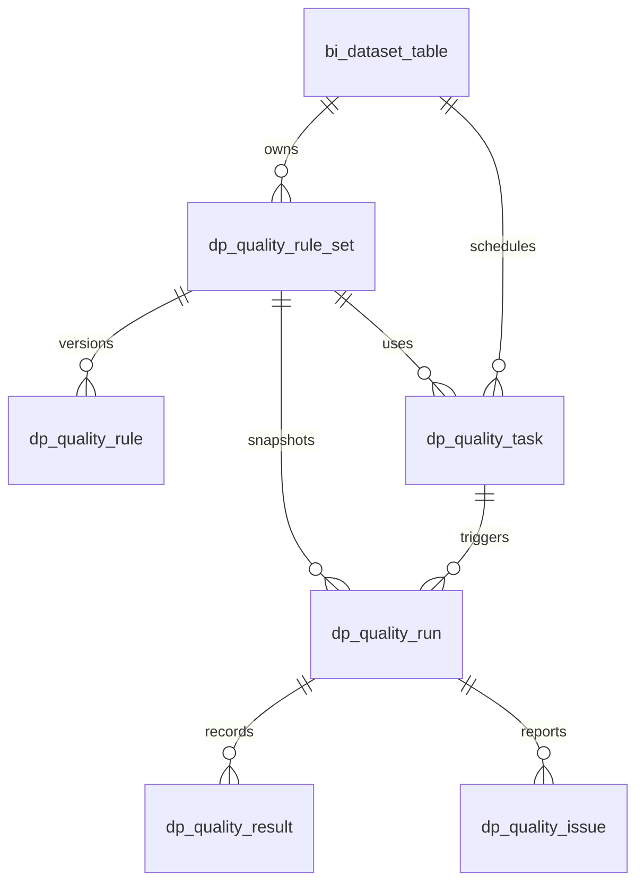

# 数据质量版本化模型

## 目标与边界

DP-013 将原 `bi_dataset_quality_rule.rules_json` 作为兼容读写入口保留，并新增可版本化的规则集、任务、运行、结果和问题实体。V32 只新增结构，不自动改写旧规则，也不执行扫描；后续 DP-014 负责干跑、等价映射、回填核对和切换。V32 不开启定时任务，调度和重试在 DP-015 实现。

## 实体关系

规则定义保存在 `dp_quality_rule_set` / `dp_quality_rule`。发布后视为不可变版本；编辑需要创建下一版本。运行行记录规则集 ID 和版本号，保证以后仍能还原当时使用的定义。规则结果记录全量/样本范围、扫描行数、通过/失败数量和耗时。问题实体预留认领和处置字段，只允许存脱敏后的样例。

## 当前 V32 表

| 表 | 用途 |
| --- | --- |
| `dp_quality_rule_set` | 数据集规则集版本、草稿/发布状态、定义哈希 |
| `dp_quality_rule` | 字段/跨字段规则、严重度、启用状态和受限配置 |
| `dp_quality_task` | 规则集执行配置、扫描范围和将来调度参数 |
| `dp_quality_run` | 每次运行的版本快照、状态、扫描范围、行数、trace ID 和幂等键 |
| `dp_quality_result` | 每条规则的计算结果和度量 |
| `dp_quality_issue` | 问题摘要、唯一键、脱敏样例及认领/处置状态 |

所有执行范围都必须遵循数据集查询权限。问题样例不得存秘密、整行敏感数据或原始大字段；错误摘要要避免拼入 SQL、凭证和原始值。样本扫描与全量精确扫描必须在运行事实中区分。全量扫描需通过数据源治理器控制超时、并发和行/字节上限。

## DP-014 迁移映射

旧规则字段 `field / required / unique / maxNullRate` 需要逐字段转换，不得把旧 JSON 当成规则配置直接复制：

| 旧字段 | 目标规则 |
| --- | --- |
| `required=true` | `NOT_NULL`，配置空值定义沿用当前空字符串按空值处理口径 |
| `unique=true` | `UNIQUE`，配置列字段；NULL 处理语义需和当前扫描实现保持一致 |
| `maxNullRate` | `NULL_RATE_MAX`，配置 0～1 比例阈值 |

一个旧字段可能生成 1～3 条独立规则；规则码在同一版本内稳定唯一。空规则迁移为空规则集并保留迁移来源。未知字段、重复字段、错误阈值 JSON 放入干跑错误报告，不自动跳过或修正。切换期先双读核对，再启用新模型；保留 V25 以便回退。

后端提供管理员迁移入口：先 `POST /bi/dataset/quality/migrations/v25/preview`（可传 `{"datasetIds":[1,2]}`；不传则预览全部），再只挑 `READY` 数据集调用 `POST /bi/dataset/quality/migrations/v25/execute`。执行一次最多 100 个数据集；每个数据集完整转换为一个已发布规则集版本。已有迁移标记会幂等跳过；坏 JSON、无效字段或阈值会在预览中标为 `BLOCKED`，执行时整批事务失败，不会静默丢弃规则。管理员应先修复/排除阻塞项，再按预览得到的 READY ID 执行。迁移不删除或覆盖 V25 JSON。

## 下一步

1. DP-013：规则集版本 API、发布/复制和 schema 校验已实现；兼容读写入口仍在使用。
2. DP-014：迁移预览/执行 API 已实现；需管理员对本地真实旧规则执行并核对。
3. DP-015：手动/间隔质量任务、启停、后台执行与运行/结果查询已实现。间隔计划支持 15 分钟至 7 天；计划保存创建者身份引用，运行时经 `LiveActorResolver` 重新读取当前身份和权限，不能沿用历史角色声明。同任务运行通过 MySQL 命名锁防重；计划通过数据库条件更新领取，避免多实例重复触发；任务中心支持取消排队/运行中的质量任务，并将取消请求传给执行线程；超 5 分钟的遗留 QUEUED/RUNNING 行会在启动时标为中断。V44 为质量运行增加父运行和尝试序号，任务可配置最多 3 次自动重试，连接瞬断/可恢复 SQL 异常/套接字超时以 15、30、60 秒退避；规则失败、权限或配置错误、取消不自动重试。历史失败仍可由任务中心手动重新提交。迁移应用和真实失败/取消回归待验收。
4. DP-016：运行历史、按日趋势、脱敏问题摘要、认领/处置和操作历史已实现；V33 增加问题处置历史表。运行结果只保留计数和规则摘要，不保存原始记录样例。待真实数据运行与多角色处置验收。
5. DP-017：质量检查接口提供字段画像；`GET /bi/dataset/{id}/quality/score` 返回最近一次 FULL 运行的规则通过率，公式为 `passedRules / executedRules × 100`，无全量规则运行时返回 `hasResult=false`。该值不是综合业务质量分；数据新鲜度评分和画像基数治理待补。

任务 API：`GET/POST /bi/dataset/{id}/quality/tasks`；`PUT /bi/dataset/quality/tasks/{taskId}/status`；`POST /bi/dataset/quality/tasks/{taskId}/run`；运行历史与逐规则结果分别为 `GET /bi/dataset/quality/tasks/{taskId}/runs`、`GET .../runs/{runId}/results`。问题 API：`GET /bi/dataset/{id}/quality/issues`、`GET /bi/dataset/{id}/quality/trend?days=30`、`GET /bi/dataset/{id}/quality/score`、`POST /bi/dataset/quality/issues/{issueId}/claim?datasetId={id}`、`POST .../resolve?datasetId={id}`、`GET .../history?datasetId={id}`。创建任务只接受已发布规则集，并且当前规则类型必须都由执行器支持；仅认领人可处置对应问题。
