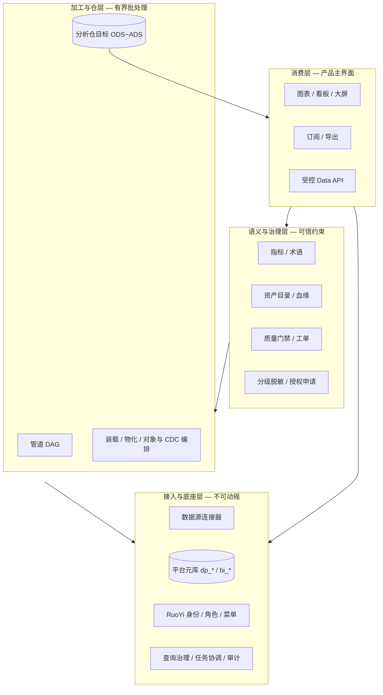
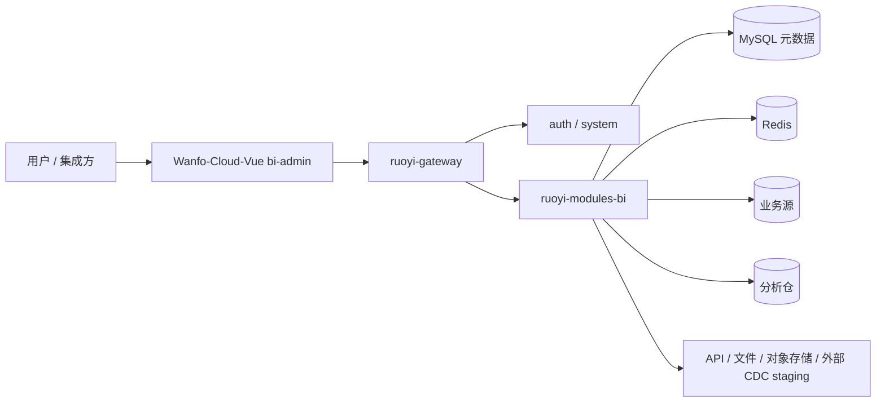

# Wanfo 产品定位与底座基线

> 版本：1.1  
> 日期：2026-11-01  
> 状态：**产品与架构决策基线（后续扩展不得与本文冲突）**  
> 适用仓库：`Wanfo-Cloud`（`ruoyi-modules-bi`）+ `Wanfo-Cloud-Vue`  
> 阶段：S2 / S3 MVP 已退出；当前加深含标准指标 schema v2、分析|数据中心双壳与三套 UI 主题  
> 配套文档：[DATA-PLATFORM-ARCHITECTURE.md](DATA-PLATFORM-ARCHITECTURE.md)、[PLATFORM-EXTENSION-ROADMAP.md](PLATFORM-EXTENSION-ROADMAP.md)、[DATA-PLATFORM-FUNCTION-CHECKLIST.md](DATA-PLATFORM-FUNCTION-CHECKLIST.md)  
> **对外入口**：[../README.md](../README.md) · **实现级功能原理（表 / 流 / 门禁）**：[SYSTEM-DESIGN.md](SYSTEM-DESIGN.md)

本文回答三件事：

1. **这个产品是什么、不是什么**（市场定位）  
2. **什么能力构成不可动摇的底座**（后续扩展的地基）  
3. **核心业务怎么流转**（功能与流程边界，防止做成第二套 DataWorks）

---

## 1. 一句话定位

**Wanfo = 企业自助 BI 为主产品，叠加「可信批处理入仓 + 轻量治理与数据服务」的受控数据平台能力。**

对外可表述为：

> **带可信入仓与指标/资产治理的企业数据分析平台**  
> （Enterprise Self-Service BI with governed warehouse ingest and data services）

**不是**：DataWorks / WeData 级一站式大数据开发治理中台替代品，也不是 Collibra 级纯治理套件，更不是通用湖仓/流计算平台。

---

## 2. 市场对位与选型边界

| 对标梯队 | 代表产品 | Wanfo 关系 |
|---|---|---|
| 自助 BI | FineBI、DataEase、Tableau / Power BI | **主赛道**：分析消费侧应对齐「可用、可管、可订阅」 |
| 指标 / 语义层 | FineBI 指标中心等 | **必须补齐的差异**：指标门户、口径、申请消费；不做独立指标中台产品线 |
| 开发治理中台 | DataWorks、WeData、DataArts、Dataphin | **只取最小可信子集**：有界入仓、管道、质量门禁、目录/血缘、受控 API |
| 专业目录治理 | OpenMetadata、Collibra、DataHub | **借鉴流程与强制策略**，不追求其政策引擎全量 |

### 2.1 明确不对齐（防跑偏）

下列能力**不作为产品成功标准**，无强业务触发不得排入主线：

- 50+ 异构源、复杂网络打通、多计算引擎混编 IDE（MaxCompute / Spark / Flink 等）
- Dev/Prod 多环境代码工厂、千万级任务调度、成本分摊中心
- 完整湖仓一体、PB 级实时链路、内嵌 CDC 引擎（可编排外部 Debezium，不自建采集内核）
- 任意用户生产 SQL / 脚本沙箱、公开数据市场、SaaS 多租户计费
- DataEase/第三方模板市场兼容、移动端深度

**2026-11-07 AI 扩展决策**：根据用户确认，原“内置 AI Copilot 后置可选”现进入独立设计与分期建设。优先围绕可信数据发现、口径问答、受控问数和可编辑图表闭环展开，复用既有权限、语义与查询底座，不扩大为通用 Agent 平台。范围、验收与建议排期见 [AI 能力设计](AI-CAPABILITY-DESIGN.md)、[任务清单](AI-DEVELOPMENT-TASK-LIST.md)、[开发排期](AI-DEVELOPMENT-PLAN.md)。文档建立不代表功能已实现。

### 2.2 必须对齐的市场观感（主线验收）

若对外称「企业 BI + 轻量中台」，采购/客户侧至少应感知到：

| # | 能力 | 对标观感 |
|---|---|---|
| 1 | 指标可统一、可追溯、可在消费侧看口径 | FineBI 指标中心（精简版） |
| 2 | 目录可搜、可申请、授权可到期 | FineBI 目录 / DataWorks 地图（精简版） |
| 3 | 入仓可重跑、失败不污染、可对账/新鲜度门禁 | 中台「脏数据不扩散」 |
| 4 | 质量可拦截生产链路 + 告警升级 | DataWorks 质量（有界） |
| 5 | 敏感策略在查询 / 导出 / API 一致强制 | 治理平台检查项 |
| 6 | 受控 Data API（Key、配额、审计、版本） | 数据服务「最后一公里」 |

---

## 3. 目标用户与价值主张

| 角色 | 主要价值 | 平台应提供的路径 |
|---|---|---|
| 业务分析师 / 运营 | 自助取数、看板、订阅 | 数据集 → 图表/看板 → 订阅；目录发现指标 |
| 数据工程师 | 把源数据变成可分析、可入仓的资产 | 数据源 → 清洗/管道 → 装载/物化 → 任务可观测 |
| 数据管理员 / 质量负责人 | 口径一致、质量可拦、责任可追 | 术语/指标、质量规则与工单、血缘与影响、分级策略 |
| 平台管理员 | 权限、凭据、审计、运行不垮 | RuoYi 权限 + 资源授权 + 查询/批任务隔离 + 审计保留 |
| 应用集成方 | 安全取数 API | Data API + Key + 配额 + OpenAPI |

**成功判据（产品级）**：同一指标在看板与 API 口径一致；入仓失败可解释且可重试；未授权与脱敏在服务端生效；批任务默认不拖垮在线分析。

---

## 4. 架构定位：四层能力模型

以现有 `ruoyi-modules-bi` 单模块部署为默认形态；「领域」是包/表前缀边界，不是强制微服务。



### 4.1 三库分离（硬约束）

| 存储 | 职责 | 禁止 |
|---|---|---|
| 平台元数据库 | 配置、目录快照、运行元信息、审计、权限 | 写入业务明细、充当数仓 |
| 业务源库 | 业务 OLTP/OLAP 只读或受控抽取 | 平台默认写回生产业务库 |
| 分析仓目标 | ODS/DWD/DWS/ADS 逻辑层物化结果 | 与元库混用同一「随意库」 |

### 4.2 控制面 / 执行面（硬约束）

| 平面 | 内容 | 约束 |
|---|---|---|
| 控制面 | 登记、定义、授权、发布、目录、规则 | 短请求；凭据不回显；写操作审计 |
| 执行面 | 扫描、质量、装载、管道生产、订阅生成、API 查询 | 异步、幂等、超时、限额、可取消；日志无秘密与行数据 |

### 4.3 部署边界（默认）

- `ruoyi-gateway` / `ruoyi-auth` / `ruoyi-system`：身份与入口  
- `ruoyi-modules-bi`：BI + 平台领域（catalog / pipeline / warehouse / quality / data-api / glossary…）  
- `Wanfo-Cloud-Vue`：`/bi-admin/*` 以 `BiWorkspaceLayout` 承载 **分析 | 数据中心** 双域壳（偏好键 `localStorage.bi-workspace-domain`）  

**拆 Worker / 独立治理服务的触发条件**：批任务与在线查询资源争抢无法用配额解决、或有明确多实例扩缩容需求。不以「模块多」为由提前拆分。

---

## 5. 底座基线（Foundation）——后续扩展必须遵守

下列条目构成**底座**。新功能可以增强，但不得绕过或另起炉灶。

### 5.1 身份与授权底座

1. 登录与组织角色沿用 RuoYi；功能码 `bi:*` + **资源级授权**（dataset / metric / data_api / pipeline…）双层校验。  
2. 浏览器不可信任：userId、组织范围、URN、sourceId 均以服务端身份重算。  
3. 查询、导出、订阅、质量样例、Data API **共用同一套数据范围与脱敏策略方向**（策略可分阶段加强，入口不得分裂）。

### 5.2 资产身份底座

1. 平台资产使用稳定 **URN**（目录、血缘、授权、审计统一引用）。  
2. BI 事实数据（数据集定义、图表定义）仍归属 BI 表；目录只建引用与元数据，**不复制第二份事实**。  
3. 新资产类型先挂目录与授权模型，再做独立产品页。

### 5.3 查询与运行底座

1. 在线分析走既有**查询治理**（超时、并发、取消、慢查询、requestId）。  
2. 长任务必须进**任务/运行记录**（可观测、可重试边界清晰），禁止「静默后台成功」。  
3. 在线池与批处理池配额隔离是默认设计目标；批任务不得默认打满 BI 连接池。

### 5.4 入仓与发布底座

1. 写入分析仓必须经受控路径（装载 / 管道生产 Publisher / 物化），**禁止**开放任意生产 SQL 写仓。  
2. 生产写入以 **staging → 校验 → 切换/发布** 为演进方向；失败保留旧可见版本。  
3. 行数、对象数、时长有**显式上限**；超限用分区计划/缩小范围，不靠「无限抬顶」伪装企业级数仓。  
4. 管道生产与装载共用发布语义，避免两套写仓实现漂移。

### 5.5 治理底座

1. 质量规则有版本；生产门禁引用**已发布**版本。  
2. 血缘区分置信度；无法解析时标记 incomplete，**禁止伪造高置信边**。  
3. 结构变更先影响分析 / 迁移计划，再改消费者；平台引用可回滚，源表不可逆变更需明示。  
4. 凭据加密（GCM，可演进 KMS）；审计与调用日志**不含**密钥与业务明细正文。

### 5.6 前端与产品壳底座

1. `/bi-admin` 以 `BiWorkspaceLayout` 为壳，顶部分域 **分析**（看板/图表/指标/填报/订阅/导出）与 **数据中心**（资产/加工装载/语义开放/治理运维）；新能力优先挂现有分组，而不是无限增加顶级菜单。  
2. 外观主题（`restrained` / `saas` / `ops`）仅改壳表现，不改变权限与数据范围。  
3. 菜单可见 ≠ 授权通过；API 负向测试是发布门槛。

### 5.7 技术栈底座

| 层 | 基线 |
|---|---|
| 后端 | Spring Boot / RuoYi-Cloud 模块、`ruoyi-modules-bi`、Flyway `dp_*` / `bi_*` |
| 前端 | Vue 3 + TypeScript + Element Plus（`Wanfo-Cloud-Vue`） |
| 元数据 | MySQL |
| 协调 | Redis（会话、锁、限流窗口等） |
| 分析仓 | 显式配置的 ClickHouse / Doris / StarRocks 等 JDBC 目标（按 ADR 扩展） |

---

## 6. 功能域地图（做什么 / 做到什么深度）

| 功能域 | 产品职责（做） | 深度上限（不做满） |
|---|---|---|
| A. 连接接入 | JDBC / API / 文件 / 对象 CSV；连通测试；凭据；周期元数据扫描 | 不追求连接器数量竞赛；湖表/实时按触发条件 |
| B. 自助分析 | 数据集、关系/清洗、图表、看板、大屏、订阅、导出 | 不做独立「全民 BI 应用商店」 |
| C. 指标语义 | 原子/派生/复合标准定义（schema v2）、定义与查询分离、发布冻结与口径取数；术语、字段标准 | 不做完整 OneData 产品线；跨数据集带维度的派生/复合等为加深项 |
| D. 加工编排 | 版本化管道 DAG、预览/生产、调度、质量门禁节点 | 不替代 Airflow/dbt/Spark |
| E. 批处理数仓 | 分层、装载、物化、对账钩子、运维页 | 有界批处理；MERGE/原子发布优先于堆连接器 |
| F. 目录血缘 | 搜索、详情、BI 回填、血缘图、影响分析 | 不做万能元数据湖 |
| G. 数据质量 | 规则版本、扫描、门禁、工单 SLA、趋势 | 模板库与隔离区可渐进，但生产拦截必须可用 |
| H. 数据服务 | Data API、Key、配额、OpenAPI、调用审计 | Serverless 网关级弹性非目标 |
| I. 安全合规 | 资源授权、行列、分级演进、审计保留、GCM→KMS | 完整多租户 SaaS 非默认 |
| J. 运维观测 | 任务中心、查询监控、Trace/指标（按部署） | AIOps 全自动非目标 |

---

## 7. 核心业务流程（产品主路径）

下列流程是**产品叙事主线**。新功能应挂接其中某条，而不是平行开一条「第二宇宙」。

### 7.1 主路径 M1：分析消费（BI 核心）

```text
登记数据源 → 授权 → 创建/发布数据集（建模/清洗可选）
  → 定义/发布指标（可选）
  → 图表 / 看板 / 大屏
  → 订阅 / 导出
```

**门槛**：每步服务端鉴权；查询受治理；订阅运行时重鉴权。

### 7.2 主路径 M2：可信入仓后分析

```text
源表/数据集 →（可选质量）→ 装载或管道生产 → 分析仓分层表
  → 注册/绑定为可查询资产 → 图表/指标/API 消费
  → 对账 / 新鲜度不达标则门禁或告警
```

**门槛**：写入走受控 Publisher；失败可重试且不静默覆盖消费者可见坏数据（演进至 staging 发布）。

### 7.3 主路径 M3：资产发现与治理

```text
元数据采集/BI 回填 → 目录检索 → 详情（口径/质量/血缘/责任人）
  → 申请授权（目标能力）→ 审批 → 消费（数据集/指标/API）
  → 变更影响分析 → 迁移或阻断
```

**门槛**：无权限不通过搜索侧信道泄露敏感名；血缘不完整时明示。

### 7.4 主路径 M4：质量闭环

```text
规则草稿 → 发布版本 → 绑定资产/管道门禁
  → 调度或触发扫描 → 结果/样例（脱敏）
  → 工单认领 / SLA → 复验通过才关闭
```

**门槛**：生产门禁引用已发布规则；样例受数据权限约束。

### 7.5 主路径 M5：数据服务出口

```text
已发布指标（或受控数据集策略）→ 创建 Data API → 授权/配额
  → 发布并下发一次性 Key → open-data 调用
  → 调用审计 / 轮换 / 停用
```

**门槛**：不能提交任意 SQL；绑定发布版本；网关白名单与 Key 鉴权并存。

### 7.6 主路径 M6：加工生产

```text
管道草稿 → 校验 → 发布不可变版本 → 预览
  → 生产运行 / 调度 → 节点状态与行数
  → 失败退避 / 任务中心重试
```

**门槛**：运行绑定 revision；生产与预览分离；质量门禁可阻断发布节点。

---

## 8. 整体逻辑架构（与实现映射）



| 用户可见模块 | 主要后端域 | 表示例前缀 |
|---|---|---|
| 工作台 / 数据集 / 图表 / 看板 | BI 核心 | `bi_*` |
| 数据资产目录 / 血缘 | catalog / lineage | `dp_catalog_*` 等 |
| 数据加工 | pipeline | `dp_pipeline*` |
| 数仓装载 | warehouse | `dp_warehouse*` |
| 质量（规则/任务/工单） | quality | `dp_quality*` |
| 开放数据 API | data-api | `dp_data_api*` |
| 业务术语表 | glossary | `dp_glossary*` |
| 任务中心 / 查询监控 | task / query governance | 既有任务与监控表 |

治理领域与 BI **共享同一部署单元**，用包与表前缀隔离；禁止再引入第二套「图表/数据集」体系。

---

## 9. 阶段性产品形态（避免一次性中台化）

| 阶段 | 对外形态 | 底座上允许建设的重点 | 退出观感 |
|---|---|---|---|
| **现在 → S1** | 企业自助 BI + 入仓/治理骨架可用 | 管道生产、装载运维、目录/血缘/术语、Data API、质量门禁 | 「能分析、能入仓、能管一点」 ✅ |
| **S2** | 带可信入仓与指标治理的企业 BI | 原子发布/MERGE、对账门禁、指标门户、目录申请审批、分级强制、质量告警闭环 | 对齐 §2.2 六项观感 ✅ 2026-10-31（见 `S2-ACCEPTANCE-RECORD.md`） |
| **S3** | BI + 轻量数据中台（可选包装） | 统一任务池、数据标准 MVP、API 版本门户、运维影响分析、密钥轮换/备份演练、Parquet 入仓、Doris/SR MERGE | ✅ MVP 2026-10-31（见 `S3-ACCEPTANCE-RECORD.md`）；加深部分已落地：公平泳道、标准域/绑批、加权金丝雀、标准指标 V64 cutover、双壳与主题（其余见 `S3-BACKLOG.md`） |
| **S4+** | 按触发扩展 | 湖表 POC、近实时隔离池、独立 Worker、内嵌 AI Copilot 等 | 有 ADR 与容量证据；非默认交付 |

**S2 / S3 MVP 已退出**。默认不再无触发扩中台；S3 加深或 S4+ 须书面触发 + ADR，禁止「对标 DataWorks 全量」无触发立项。

---

## 10. 决策与需求准入（防跑偏清单）

新增需求进入排期前，产品/研发应能回答：

1. **挂接哪条主路径（M1–M6）？** 挂不上则默认暂缓。  
2. **是否绕过底座（§5）？** 绕过则否决或先改底座。  
3. **属于 §2.1 不对齐清单吗？** 是则需书面业务触发 + ADR。  
4. **验收是「页面能开」还是「服务端负向 + 失败可恢复」？** 仅前者不得标完成。  
5. **是否制造第二套资产/权限/写仓路径？** 是则合并到现有路径。

### 10.1 与既有文档的关系

| 文档 | 角色 |
|---|---|
| **本文** | 产品定位与底座宪章；冲突时以本文为准修订其他文档 |
| 根目录 `README.md` | 对外项目介绍与功能总览入口（边界服从本文） |
| `SYSTEM-DESIGN.md` | 实现级原理（表 / 流 / 门禁）；功能怎么落地以该文为准 |
| `DATA-PLATFORM-ARCHITECTURE.md` | 目标技术架构与原则（应服从本文定位） |
| `DATA-PLATFORM-FUNCTION-CHECKLIST.md` | 功能与验收细项（状态以代码为准，范围受本文裁剪） |
| `PLATFORM-EXTENSION-ROADMAP.md` | 近端实施勾选与边界（§7 数仓差距在本文 S2/S3 内消化） |
| `S2-DEVELOPMENT-PLAN.md` | S2 任务总表（W1～W4 已关闭） |
| `S2-ACCEPTANCE-RECORD.md` | S2 六项观感验收记录 |
| `S3-ACCEPTANCE-RECORD.md` | S3-01～S3-08 轻量中台 MVP 验收记录 |
| `S3-BACKLOG.md` | S3 可选包装 backlog 与加深项（防范围回潮） |
| `COMMERCIAL-VALUE-BACKLOG.md` | 商业价值后续开发清单（成交闭环 / 过审 / 差异化；待排期） |
| `superpowers/plans/2026-10-31-s2-wave1-warehouse-trust.md` | S2 Wave1（仓可信）可执行实施步骤 |
| `DATA-WAREHOUSE-*` / `DATA-*-MODEL.md` | 领域细则，不得突破本文「有界批处理 / 非中台替代」 |

---

## 11. 产品命名建议（对内一致）

| 场景 | 建议称呼 |
|---|---|
| 对业务用户 | 数据中心 / 数据分析平台 |
| 对数据团队 | Wanfo BI + 可信入仓与治理 |
| 对管理层汇报 | 企业自助分析平台（含受控入仓与数据服务） |
| 避免自称 | 「一站式大数据中台」「DataWorks 平替」「企业级数据湖平台」 |

---

## 12. 修订规则

- 变更本文 §1–§5、§9–§10 需架构/产品书面同意，并同步更新路线图优先级说明。  
- 仅增补流程示例或映射表，可小版本修订（1.x）。  
- 实现细节以代码与 Flyway 为准；本文管「方向与边界」，不管「类名是否最新」。

### 12.1 变更记录

| 日期 | 说明 |
|---|---|
| 2026-10-31 | 初版 1.0：定位、底座、主路径与 S1–S4+ 阶段 |
| 2026-11-01 | 1.1：对齐标准指标 v2、双壳/主题与 S3 加深落地；文档关系补 README / SYSTEM-DESIGN |
| 2026-11-02 | 文档关系增加 `COMMERCIAL-VALUE-BACKLOG.md`（商业价值后续清单） |
