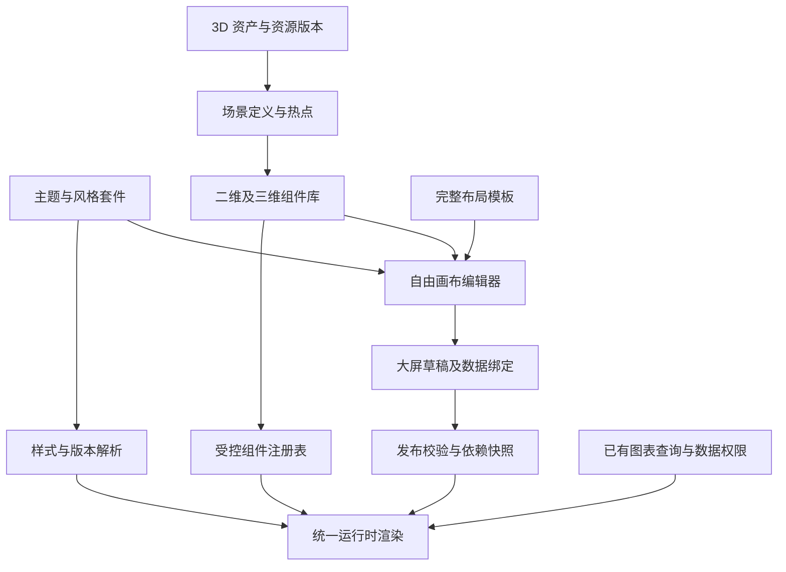

# 大屏主题、自由模板与 3D 组件中心设计

> 版本：0.1（设计稿）  
> 日期：2026-11-02  
> 状态：待按本文的实施阶段开发和验收，不能视为已上线功能  
> 适用项目：wanfo-bi-cloud  
> 工作约定：本轮文档与现有代码均保留在本地，不提交、不推送。

## 1. 设计结论

建设一套共用的创作体系：**视觉主题 + 自由画布 + 二维/三维组件库 + 可编辑模板**。

用户可以复用智慧食堂原型的完整页面，也可以只采用它的视觉风格，自行安排全部布局。后续新增原型时，优先通过主题、组件外观变体和素材扩展；涉及新的图形表达或交互时，再开发新的组件能力。

3D 组件中心属于这套体系，负责资产、场景和可复用组件的制作管理。大屏编辑器负责组件实例的摆放、数据绑定和交互配置，继续使用平台已有的查询、权限、发布和刷新链路。

“任意原型或模型导入后完美适配”不作为承诺。目标是：已支持的组件与视觉能力可以配置复用，未支持的能力能够被识别、提示并按协议扩展。

## 2. 与既有设计和实现的关系

相关文档：

- [图表、看板与大屏整体改造计划](BI-CHART-DASHBOARD-SCREEN-REDESIGN-PLAN.md)
- [3D 大屏能力改造任务清单](3D-SCREEN-CAPABILITY-TASK-LIST.md)
- [3D 场景配置协议 v1](3D-SCENE-CONFIG-V1.md)
- [二维驾驶舱与刷新策略验收](3D-SCREEN-2D-ACCEPTANCE.md)

本文补充前述计划中的主题、模板和资源管理设计。后续任务应统一遵循本文的自由布局、样式继承和资产版本原则；既有地图、刷新、权限等任务仍按原清单推进，不建立相互矛盾的第二套实现。

### 2.1 当前基础与新增范围

以下“已有”以本地代码为依据，部分修改尚未提交；真实浏览器、跨角色和 GPU 验收仍有待执行项。

| 领域 | 当前基础 | 本设计新增内容 |
|---|---|---|
| 大屏画布 | 绝对定位、栅格、拖拽缩放、组合、图层、容器及装饰 | 主题化插入、风格套件、可复用组合块 |
| 外观 | `DashboardAppearance` 基础颜色、调色板、字号、圆角；有限面板样式 | 版本化主题、语义样式变量、渐变光效、组件外观变体、局部覆盖 |
| 模板 | 布局文件、市场、本地模板、槽位绑定与验证 | 完整布局/仅用风格两种入口、允许未绑定草稿、主题及组件依赖清单 |
| 数据 | 数据集、图表查询、字段映射、筛选、联动、权限及发布快照 | 组件输入角色、类型约束、替换影响预览，不另建查询引擎 |
| 3D | 程序化建筑、数据柱图、行政区地图、相机预设、降级和资源清理 | 资产库、GLB 加载、场景制作、热点、组件封装、资源版本及使用授权 |
| 渲染 | 画布和卡片在预览、查看及模板布局预览中复用 | 统一组件注册、样式解析和版本解析，稳定生成预览与发布快照 |

关键代码基线：

- `Wanfo-Cloud-Vue/src/api/bi/dashboard.ts`：大屏、面板、基础外观及 v1 场景协议。
- `Wanfo-Cloud-Vue/src/views/bi/dashboard/DashboardTemplatePicker.vue`：模板创建与绑定流程。
- `Wanfo-Cloud-Vue/src/utils/biTemplateFiles.ts`：严格模板解析、导入和实例化。
- `Wanfo-Cloud-Vue/src/views/bi/dashboard/DashboardCanvas.vue`、`DashboardCard.vue`：共用画布及面板渲染。
- `Wanfo-Cloud-Vue/src/views/bi/dashboard/SchoolCanteen3DScene.vue`：现有 3D 场景基础，尚不是通用模型资产编辑器。

### 2.2 必须解决的协议缺口

1. 当前外观字段和调色板枚举不足以表达任意主题；扩展不能只增加一个主题名称。
2. 现有模板实例化要求完整绑定数据。实现“先采用设计、后绑定数据”需要显式支持未绑定草稿。
3. 现有 `Scene3DConfig` v1 没有资产、图层和热点引用；这些能力须新增版本，不能直接塞入旧严格解析器。
4. 现有程序化模型需要保留兼容，不能因建设资产库而让旧大屏失效。

## 3. 产品目标和范围

### 3.1 本轮目标

- 复用原型 UI 时，用户能够自由新增、移动、删除和替换组件。
- 修改数据集、字段和查询条件时，保留组件外观及布局。
- 新增常用图表时，自动取得与当前大屏一致的完整样式。
- 新增原型可沉淀为主题、素材、组件外观和布局模板。
- 将 3D 资产制作成可拖入大屏的组件，支持配置和受控数据交互。
- 发布内容固定主题、组件、场景和资产版本，可回滚。

### 3.2 首期边界

首期实现科技蓝主题、同风格二维组件套件、两种模板创建入口，以及单个 GLB 建筑资产的加载、场景配置、热点绑定和发布。保留现有行政区地图与程序化场景。

复杂 BIM 编辑、CAD 建模、任意 JavaScript 插件、任意远程模型加载、通用粒子特效编辑器、浏览器内三维建模，以及全部设备上相同的 4K 渲染效果，不作为首期验收要求。

## 4. 代表性产品流程与本项目采用方式

官方文档中的代表性流程：

| 产品 | 可确认的流程或能力 | 本项目借鉴点 |
|---|---|---|
| DataV | 选择模板、填写名称和分组，创建后进入画布编辑器 | 模板作为可继续编辑的起点 |
| 腾讯云 BI | 预览并应用模板，将模板及配套数据集带入项目，进入编辑器修改 | 复用视觉和页面结构，降低重复搭建 |
| FineVis | 复用模板、组件和素材，组件可拖入画布；市场提供主题套件 | 整屏模板与组件级复用并存 |

参考来源：[DataV 创建数据看板](https://help.aliyun.com/document_detail/2591827.html)、[腾讯云 BI 应用模板创建](https://cloud.tencent.com/document/product/590/119603)、[FineVis 资源复用](https://help.fanruan.com/finereport/doc-view-5065.html)、[帆软主题套件市场](https://app.fanruan.com/templates/list)。不同产品和版本存在差异，上表不构成市场占有率判断。

本项目采用“轻量创建 → 编辑器完善 → 发布强校验”。已有的业务槽位绑定向导保留为快捷路径，用户也可直接进入编辑器设计。第三方产品是否复制配套数据集，不作为本项目复制凭据或业务权限的依据。

## 5. 用户流程

### 5.0 模板中心入口（已确认）

模板中心只保留“模板市场”和“我的模板”两个入口。原“本地模板库”更名为“我的模板”，包含自己保存、导入及有权使用的模板；团队共享通过资源授权管理，不设第三个独立栏目。

两个入口统一采用“预览完整效果 → 选择可用版本 → 使用完整布局 / 仅使用视觉风格”的流程。主预览应展示完整风格、图表、装饰和可用场景；使用明确标识的演示数据，不自动查询用户业务。真实数据预览在绑定后进行。封面可使用渲染图片，效果预览必须由可还原的模板配置生成；当前原型未能由配置表达的部分，需先补齐组件能力。

**首批实施状态：**两个栏目和共用预览已接通，“仅使用视觉风格”能将当前 v1 基础外观及画布尺寸快照带入空白编辑器，不复制布局、查询绑定、过滤器或刷新周期。预览默认使用独立演示数据展示当前模板实际可渲染的风格，可切换无数据布局结构或全屏查看；覆盖指标卡、柱图、折线/面积图、饼/环图、表格及行政区地图，其余类型暂显示占位。演示数据不写入草稿，不调用业务查询接口；地图仍需获取已有地理资源。完整布局仍走已有绑定向导。原型全部光效与组件皮肤、不可变模板版本、未绑定数据组件草稿和高级主题变量尚未完成，不将本批视为整个主题体系已交付。

### 5.1 使用完整布局

1. 在模板中心预览页面与组件依赖，选择“使用完整布局”。
2. 填写名称、项目和设计尺寸，创建独立草稿。
3. 进入编辑器，带入主题、静态素材、布局及组件外观。
4. 自由增删和移动组件，绑定图表或数据集；可批量映射字段。
5. 预览真实数据，处理绑定、权限、资源和性能提示，再发布。

模板的预设位置可全部调整。模板中的组件数量和业务槽位不是实例后续编辑的上限。

### 5.2 仅使用视觉风格

1. 选择主题或模板，点击“仅使用视觉风格”。
2. 创建采用该主题的空白画布，可单独选择画布比例与尺寸。
3. 从主题推荐组件中拖入标题、指标卡、图表面板、装饰或 3D 场景。
4. 组件自动取得当前主题对应的样式，用户自行布局、绑定数据并发布。

此入口不强制带入原模板的九个食堂数据槽，也不复制原模板的筛选、业务字段、阈值、数据绑定或交互依赖。

### 5.3 编辑现有大屏时使用其他主题

先生成切换预览，展示受影响的组件、局部自定义、缺失的风格变体和不支持的能力。用户确认后修改草稿，支持撤销。发布版本不因主题库更新而自动变化。

### 5.4 使用 3D 组件

从组件中心选择并拖入组件 → 调整布局和外观 → 设置场景属性 → 映射学校/楼栋/设备等业务编码 → 配置指标和交互 → 预览 → 发布。

普通使用者无需重新调试模型的默认相机、灯光和尺寸，也无需手工编辑场景 JSON。

## 6. 总体架构

主题、组件、场景、资产通过明确的标识和版本关联。运行时只解析注册过的组件和受支持属性，不根据任意字符串加载 Vue 文件、脚本或网络插件。

## 7. 视觉主题与组件外观

### 7.1 主题内容

| 类别 | 配置示例 |
|---|---|
| 画布 | 纯色/渐变背景、纹理、背景资源、缩放方式 |
| 文字 | 字体、标题层级、数值字体、正文与辅助文字颜色 |
| 面板 | 背景、透明度、边框、圆角、阴影、发光、内边距 |
| 图表 | 系列调色板、轴线、网格线、图例、标签、提示框及类型默认样式 |
| 装饰 | 标题条、角标、分隔线、轮廓、强调光效 |
| 状态 | 正常、注意、异常、禁用、缺失数据等语义角色 |
| 3D 可选外观 | 背景、标签、强调色、选中色、允许开放的灯光参数 |

主题内不保存采购金额字段、学校编码、SQL、账号、聚合口径或业务告警阈值。状态颜色可由主题定义外观，但严重程度及文字含义由业务规则决定，并保留非颜色提示。

### 7.2 解析优先级

从低到高为：组件内置默认值 → 大屏主题 → 图表类型默认样式 → 组件外观变体 → 实例局部覆盖。

业务数值格式和告警规则单独解析，不参与普通换肤覆盖。金额、百分比、计量单位、正负方向和缺失值含义不随主题变化。

组件属性面板显示“跟随主题”或“已单独设置”，支持按属性、按组件恢复跟随主题。用户手工设置过的样式，在切换主题时默认保留，并可预览后选择重置。

### 7.3 图表引用策略

- 默认复用已保存图表的查询与字段配置，采用当前大屏的视觉样式；保留业务数值格式、语义颜色和告警含义。
- 提供“采用源图表样式”显式选项，将适用的视觉样式作为实例覆盖；不修改源图表。
- 更换数据集或字段，只调整映射和相关校验结果，保留位置、边框、标题、图例等无关样式。
- 更换图表类型时，保留公共外观，改用新类型的默认样式；不适用属性应提示并保留可撤销的迁移记录。
- 系列颜色优先绑定稳定系列标识。新增系列分配调色板，系列顺序变化不应导致已存在系列颜色随机变化。

### 7.4 缩放和内容适配

优先采用可缩放的矢量装饰、CSS 边框或九宫格资源。文本不烘焙进背景图，图表不烘焙进装饰图。

组件声明最小可用尺寸、建议比例、文字溢出策略和标签密度。缩放时图表重新布局，边框及角标维持合理比例。数值无法完整显示时提示调整尺寸或展示单位，不静默隐藏符号、单位和关键数位。

### 7.5 智慧食堂原型的视觉还原基线（当前优先项）

当前的基础外观快照和通用演示预览，不代表智慧食堂 3D 原型已经完成模板化。原型由独立 Vue/CSS/SVG 实现，而当前模板由有限的 `DashboardAppearance` 与普通面板表达；演示数据补全后，这一结构差距仍然存在。

以 `SmartCanteenScreen.vue` 为视觉基准，先将以下元素变为编辑器可使用、可保存和可发布的能力：

| 编号 | 原型元素 | 当前差距 | 必须落实的能力 |
|---|---|---|---|
| VIS-01 | 多层渐变背景、暗纹、区域光晕 | 当前主要为纯色背景 | 主题背景层、纹理/装饰资源引用及参数 |
| VIS-02 | 品牌图形、主副标题、中部装饰线、地区与时间区 | 当前普通文本框不能还原完整标题结构 | 可拆分/组合的标题栏、装饰和筛选展示组件 |
| VIS-03 | 图标、数字、独立单位、对比信息、迷你趋势组成的指标卡 | 当前主要是单值指标卡 | 组合指标卡及对应风格变体；各数据角色独立绑定 |
| VIS-04 | 科技面板、标题序号、内边距、描边、渐变及光效 | 当前通用卡片背景/边框/圆角不足 | 通用科技面板皮肤，可作用于不同图表并自由调整尺寸 |
| VIS-05 | 拟 3D 柱形、环图中心信息、面积渐变、定制图例及标签 | 当前通用图表默认样式与原型不同 | 类型专属风格预设与必要的受控渲染变体，真实数据仍走原查询 |
| VIS-06 | 预算进度、设备状态、安全评分及事件列表 | 当前模板只迁移了部分图表槽位 | 可复用进度、状态、评分和事件组件，展示与业务口径分离 |
| VIS-07 | 中心场景与标题、页签、状态说明形成的整体区域 | 当前独立场景面板缺少组合结构 | 场景容器组合块；相机、标签、外观与组件布局分别配置 |
| VIS-08 | 左中右比例、面板间距、文字层次和整体信息密度 | 当前二维模板布局与完整原型不等同 | 由上述组件重建一份原型布局，可自由增删、移动并调整比例 |

开发顺序调整为：协议与样式解析基线 → VIS-01/02/04 → VIS-03/05 → VIS-06/07 → VIS-08 → 多风格及版本扩展。已完成的查询、权限、模板入口和刷新机制继续复用。通用扩展不能代替首套原型视觉闭环验收。

效果预览、编辑器和发布查看必须使用上述真实组件及同一份生效外观配置。不能仅将独立原型页面或其截图作为可创建模板的完整效果预览；若某项组件仍未支持，应标明差距，不能声称已还原。

视觉验收固定采用相同分辨率、相同演示数据和相同相机/状态，逐区对照背景、标题、指标卡、面板、图表和场景。记录可接受的渲染差异，不用“深色背景一致”替代整屏验收。随后再用真实数据检查长标题、大数值、空值、系列增减和组件缩放。

通过门槛：预览呈现原型的主要视觉特征；从模板创建后公共 UI 无需逐项重新调整；仅用风格时新增组件自动取得相应风格；布局仍可完全自行设计。此前保持“原型视觉还原未完成”的状态。

## 8. 模板和组件套件

### 8.1 三类复用产物

| 产物 | 内容 | 实例化行为 |
|---|---|---|
| 完整模板 | 布局、主题引用、静态素材、组件配置、可选数据角色和交互规则 | 创建独立大屏草稿，全部布局可编辑 |
| 主题套件 | 主题版本、同风格素材、推荐组件及外观变体 | 应用主题并提供组件推荐，不带业务布局 |
| 组合组件 | 标题/装饰/图表等组合、相对布局及开放属性 | 整体拖入，可复制、改尺寸，允许按规则解除组合 |

智慧食堂原型首轮应同时交付完整驾驶舱模板、“科技蓝”主题和同风格组件套件，三者共用视觉配置。

### 8.2 未绑定草稿

新协议必须明确区分：静态组件、未绑定数据组件、已绑定数据组件、已停用组件。

未绑定组件只保存图表类型、外观和字段角色要求，不伪造 `chartId`，不生成业务结果。草稿可保存，预览显示占位及绑定入口；默认情况下，发布校验拒绝仍启用且缺少必需绑定的数据组件。用户可补齐、移除或明确停用后再发布。

现有模板解析及实例化要求完整绑定，需要增加对应的草稿协议和后端校验分支。不能仅通过前端绕过向导或删除校验完成改造。

### 8.3 数据角色

组件输入采用“分类、时间、度量、地区编码、对象编码、状态”等角色描述，业务模板可再附加具体口径。自由画布的通用组件不强制采购、用餐等食堂字段。

自动映射可依据字段类型、显示名、语义标签给出建议，必须展示映射结果。不能仅凭字段同名认定聚合、币种、单位或事实粒度正确。

### 8.4 跨项目与导入导出

模板包包含版本清单、主题和组件依赖、允许携带的静态资源、数据角色及预览图。不携带凭据、用户查询结果、角色授权或可直接使用的跨项目业务资源 ID。

同项目可复用有权限的资源引用；跨项目导入时由用户重新绑定，或在有复制权限的情况下创建新资源并重写引用。资产素材可否分发须由其授权范围决定。

## 9. 新原型适配流程

| 新原型变化 | 优先处理方式 | 不能自动保证的部分 |
|---|---|---|
| 配色、字体、背景、圆角、图表默认风格 | 新主题 | 字体资源与不同尺寸下的实际排版 |
| 新标题栏、边框、指标卡、装饰面板 | 新外观变体和素材套件 | 异形结构的缩放与文字容纳 |
| 新组合区域或排列方式 | 新组合组件和布局模板 | 业务内容改变后的信息密度 |
| 新交互、图形、动画、3D 场景 | 扩展组件能力，再封装套件 | 性能、兼容性及数据语义 |

标准流程：拆解原型 → 对照组件能力矩阵 → 识别缺失能力 → 制作主题/素材/组件 → 在多种布局和数据状态下验收 → 发布版本。

导入原型图片只作为设计参考，不直接宣称图片可以自动转成可编辑、可绑定数据的大屏。

## 10. 3D 组件中心

### 10.1 模块划分

| 子模块 | 职责 | 产物 |
|---|---|---|
| 3D 资产库 | 上传、校验、元数据、预览及版本管理 | 模型、贴图、环境资源、静态封面 |
| 场景管理 | 组合资产，配置相机、灯光、图层和语义锚点 | 可编辑场景及场景版本 |
| 3D 组件库 | 封装场景，声明开放属性、数据角色、事件和降级 | 可直接拖入大屏的组件版本 |
| 引用与运行信息 | 查询使用位置、依赖和加载情况 | 引用关系、兼容提示和诊断信息 |

组件库可包含现有程序化建筑、行政区地图、数据柱图，也可包含后续导入的建筑或设备场景。所有组件通过同一注册机制进入大屏编辑器。

### 10.2 资产导入

首期优先支持 GLB。上传后由服务端检查真实格式、版本、长度、扩展、几何及贴图信息，提取尺寸、包围盒、节点、网格、三角形数量和资源依赖，生成可追溯的资产版本。

外部贴图和模型依赖统一转成受控资源引用；首期不直接加载任意远程 URI、磁盘路径或脚本。允许的扩展、文件大小和纹理预算由平台策略声明，超限给出明确说明。

记录资产来源、使用范围和上传者。预览生成失败不将资产标为可用。生成任务具备状态、重试及错误原因；必要时允许有权限用户提交静态封面作为待审核替代。

### 10.3 场景制作

场景编辑器提供：

- 添加、替换和组合资产，调整位置、旋转、缩放及坐标轴。
- 初始相机、目标点、视角预设、缩放边界和旋转约束。
- 灯光、环境、背景、图层显隐和默认选中状态。
- 语义锚点、热点、标签、选中外观与受控状态映射。
- 加载、错误、无数据、无权限、无 WebGL 和静态封面预览。

模型变换、镜头和物体空间关系在场景中配置；页面上的组件位置及尺寸在大屏中配置，二者分别保存。

### 10.4 热点与业务绑定

保留三种身份：资产内部节点标识、场景语义锚点、业务对象编码。

例如：模型某节点映射为场景锚点 `dining-building`，大屏实例再将该锚点绑定到查询结果中的楼栋编码。业务编码不直接写入可跨项目共享的基础模型，节点显示名称也不充当长期业务主键。

绑定配置声明对象编码、指标、状态和时间等字段。运行时将授权结果映射到标签、颜色、显隐和详情；匹配不到对象、编码重复或字段变化时提示，不擅自合并结果。

点击热点可发出对象选择、筛选、下钻或打开已注册详情等事件。事件只携带允许的业务值，查询范围和权限由后端校验，不接受任意 SQL、脚本或跳转地址。

### 10.5 跟随主题

组件明确声明可跟随主题的属性，例如背景、标签、轮廓、选中色和强调灯光。真实材质与纹理可保持模型原样；不得默认对全部材质强制换色。

状态与告警使用语义角色映射，并同时提供文字或图标。主题切换不改变严重程度和业务阈值。

### 10.6 运行与降级

- 资产按需加载；使用资源版本和校验值作为缓存键。
- 共享资产采用引用计数或明确所有权，组件销毁只释放自己持有的实例和引用，不能误释放其他场景资源。
- 页面隐藏、离屏和路由停用时暂停动画；退出时清理监听、定时器、请求和 WebGL 资源。
- 单组件、整屏的模型、纹理、内存、同时活跃渲染器和帧率预算分别配置，设备档位实测后确定发布阈值。
- 无 WebGL、资源不可用或超过预算时使用静态封面；地图可使用同源二维边界，关键业务数据仍提供可访问的文字/列表表达。
- 多个 3D 组件不代表允许无限创建 WebGL 上下文；首期优先单主场景，后续按实测结果开放多场景预算。

### 10.7 数据更新与运行时刷新

数据绑定提升配置、复用和治理体验，实时性还依赖源数据更新、同步/计算、缓存及屏幕刷新链路。

场景业务数据沿用统一刷新调度，不为每个热点单独建立无界轮询。业务数据刷新尽量增量更新标签和状态，不重复下载同一版本模型或重建整个场景。查询复用与缓存必须包含身份、权限范围及查询条件，不跨租户泄露结果。

界面分别展示可获得的源数据更新时间、最近查询成功时间和资源加载状态。没有可信的源更新时间时显示未知，不能用渲染时间代替。手动刷新、隐藏暂停、超时、退避和允许显示旧数据的时长应有统一策略；端到端延迟另按现有任务清单验收。

## 11. 核心实体及版本关系

以下是逻辑模型，不是已执行的建表脚本。具体命名、复用现有表和迁移方案在实现前进一步确认。

| 实体 | 关键内容 | 版本与权限 |
|---|---|---|
| Theme / ThemeVersion | 语义样式、类型预设、变体和依赖 | 草稿可编辑；发布版本不可变 |
| Component / ComponentVersion | 注册类型、属性协议、输入角色、事件、默认外观、降级和能力声明 | 阅读、使用、编辑、发布分别授权 |
| Asset / AssetVersion | 存储标识、校验值、元数据、依赖和预览 | 上传、使用、复制、发布与撤回分别管理 |
| Scene / SceneVersion | 资产版本、变换、相机、灯光、图层、锚点和热点 | 固定引用资产版本 |
| Template / TemplateVersion | 布局、主题/组件依赖、数据角色和适配约束 | 固定依赖清单 |
| DashboardDraft | 布局、组件实例、版本引用、局部覆盖、数据绑定和交互 | 允许明确的未绑定状态 |
| DashboardPublication | 生效配置及完整依赖快照 | 保留历史版本，支持回滚 |
| ResourceReference | 引用者、被引用资源、具体版本和使用位置 | 用于影响分析及清理判断 |

资源管理权限与业务查询权限独立：有权使用建筑模型，不等于有权查询该学校数据。资源需要遵循平台现有租户、项目及组织边界；共享操作应明确范围，不能因应用模板而自动复制授权。

发布快照包含解析后的外观、生效组件配置、数据查询配置版本和资产版本引用；不保存用户查询结果、密码或长期可外传的访问令牌。运行时按当前访问者或受控嵌入身份执行数据权限。

## 12. 发布、升级、回滚和删除

1. 创建时固定主题、组件、场景和资产版本，不跟随资源库“最新版本”自动改变。
2. 发布前校验全部依赖可用、资源使用权限、必需数据绑定、兼容性、降级及预算。
3. 发布事务保存完整依赖清单；运行时通过受控清单解析资源，必要访问地址为短期且受授权约束。
4. 资源新版本发布后，只提示受影响草稿可升级；用户查看差异、迁移预览并确认，支持撤销。
5. 旧发布版本继续使用原版本，回滚须同时恢复配置及其依赖引用。
6. 被已发布大屏引用的资源版本不能普通硬删除。先停用或替换引用，满足保留期及审计要求后再清理。
7. 权限撤销或资源因安全原因被强制撤回时，不能以“版本固定”为由继续泄露资源；运行时拒绝加载并显示降级说明。

## 13. 协议、接口和兼容

### 13.1 建议协议分层

- 大屏文档：布局、主题引用、组件实例和交互。
- 组件实例：组件版本、开放属性、局部外观、数据绑定和资源覆盖。
- 场景定义：场景版本、资产版本、相机、图层和语义锚点。
- 资源清单：资产标识、版本、校验值和依赖，不使用用户自填任意地址。
- 发布清单：以上依赖的解析结果和兼容性版本。

上述内容先制定 v2 JSON Schema / Java / TypeScript 协议，再修改导入、保存、预览和发布校验。不能只在前端增加属性。

### 13.2 建议接口能力

| 领域 | 必要操作 |
|---|---|
| 主题 | 列表、详情、应用预览、保存草稿、发布、升级影响 |
| 组件 | 列表、能力声明、属性协议、实例化、版本管理 |
| 资产 | 上传会话、完成校验、处理状态、预览、版本、依赖和使用授权 |
| 场景 | 草稿保存、校验预览、发布、版本比较、资产替换与锚点重映射 |
| 模板 | 依赖解析、两种创建方式、资源/数据重新绑定、导入导出 |
| 大屏 | 草稿、真实预览、发布校验、发布清单和回滚 |

具体 URL 沿用项目现有接口约定，业务处理放在后端服务中，保持统一鉴权、乐观锁、错误响应及审计。

### 13.3 旧配置迁移

- 旧大屏继续使用现有外观与场景 v1；默认不自动套用新主题。
- 旧内联样式迁移为等效实例覆盖，升级前后进行视觉对照。
- v1 程序化建筑、地图和柱图保留内置组件适配器。
- 新能力以新版文档保存；旧客户端遇到不支持版本应只读或降级，并禁止覆盖保存原始配置。
- 历史发布快照保留；迁移只作用于用户确认的草稿。

## 14. 减少手动 UI 配置的具体保障

| 用户动作 | 默认结果 | 必须提示的例外 |
|---|---|---|
| 替换数据集或字段 | 保留布局和无关外观 | 类型、单位、粒度或系列含义变化 |
| 新增常用图表 | 自动取得主题及该类型完整预设 | 主题缺少该类型变体时明确回退 |
| 引用已有图表 | 默认采用大屏视觉，查询独立引用 | 用户可显式采用源图表外观 |
| 改尺寸 | 内容重排，装饰保持比例 | 小于最小可用尺寸时提示 |
| 切换主题 | 保留布局、数据和交互 | 显示局部覆盖、缺失素材及不兼容组件 |
| 替换 3D 资产 | 保留场景/业务绑定并尝试锚点重映射 | 锚点缺失、比例坐标变化需确认 |
| 新建其他风格原型 | 复用已有组件，新增主题和素材 | 新交互或特殊图形需要开发 |

不能以“同色背景”作为样式适配完成的标准。图表内部轴线、图例、提示框、标签，及静态装饰、组件状态都需要纳入主题。

## 15. 实施顺序与交付门槛

| 阶段 | 内容 | 交付与通过条件 |
|---|---|---|
| P0 协议基线 | 主题变量、组件注册、引用版本、未绑定草稿、兼容规则 | 前后端协议样例与迁移校验完成；旧大屏不被重写 |
| P1 主题与自由创建 | 科技蓝主题、仅用风格入口、组件默认样式、局部覆盖 | 空白画布自由布局；替换数据无需重配公共外观 |
| P2 模板与套件 | 完整布局副本、同风格组件、组合复用、依赖清单 | 可增删全部组件；缺绑定可存草稿，发布强校验 |
| P3 3D 资产与场景 | GLB 导入校验、预览、相机、图层、静态封面 | 单建筑资产可由管理模块配置并在大屏加载 |
| P4 3D 组件与业务绑定 | 锚点、热点、指标、事件和主题开放属性 | 稳定业务编码绑定，权限正确，替换资产可查看影响 |
| P5 多风格及发布闭环 | 第二套主题、差异预览、版本升级、回滚、预算 | 同一大屏换风格后数据和布局保留；发布依赖可恢复 |
| P6 多设备验收 | 普通电脑、电视/4K、低配降级、长时间运行 | 在明确设备档案和预算下验收，无资源持续增长 |

主题/自由创建与 3D 资产场景是两条可分阶段交付的工作线，共用协议和资源管理基础。首轮不同时重写查询引擎、全部图表和整个资产平台。

每阶段需有示例、迁移说明、自动化检查和真实页面验收记录。只有代码完成不能直接标记阶段验收通过。

## 16. 验收标准

1. 同一科技蓝主题能制作中心地图、左右分析和纯指标三种不同布局，不要求修改源代码。
2. 从完整模板创建后，可新增、删除、移动和替换任意普通组件，关联筛选/联动依赖得到同步检查。
3. 仅用风格创建时，不强制出现食堂数据槽、业务字段或原型布局。
4. 更换数据源和映射字段后，原组件公共视觉无需重新配置；单位与口径变化有提示。
5. 新增柱图、折线图、环图、表格、指标卡时，具有完整主题样式；不支持的类型有明确回退说明。
6. 第二套明显不同的风格可通过主题/素材/外观变体实现；特殊能力缺失能够识别，不承诺自动还原任意图片。
7. 3D 组件拖入后有可用初始视角、加载反馈、属性面板和降级；普通用户不手写 JSON。
8. 热点按稳定业务编码关联授权结果，缺失、重复或无权限数据不被伪造为正常状态。
9. 同一模型在不同主题下只改变声明允许跟随主题的属性，材质与告警含义符合配置。
10. 主题、组件或资产发布新版本，不自动改变已有发布大屏；升级可预览，回滚能恢复具体依赖。
11. 无查询、资产或发布权限的操作被后端拒绝；模板导入不复制业务权限。
12. 编辑、真实预览、发布和缩略图使用一致的生效配置；无业务数据预览明确显示占位标识。
13. 以 1920×1080 为基线，再验证普通电脑窗口和 4K 展示；按设备预算检查查询并发、帧率、内存和降级。
14. 反复打开/关闭、换主题、换模型、切范围及长时间运行后，无持续残留的监听、请求、定时器和 GPU 资源。

## 17. 设计点评

### 17.1 总体判断

方向可行，且与当前自由画布、查询权限和场景基础兼容。主要收益是将后续原型的重复开发工作逐步转化为主题、素材和组件配置。它是一项创作体系改造，不能通过增加几个模板或一个模型上传菜单完成。

### 17.2 设计中值得保留的部分

- 视觉、布局、查询与空间场景各有边界，便于复用及独立演进。
- 完整模板和仅用风格并存，同时满足快速交付与自由设计。
- 3D 复用原有业务查询与权限，避免产生第二条未经治理的数据通道。
- 发布固定依赖版本，能控制主题与资产升级对已投屏页面的影响。
- 提前设计缺失、异常和降级状态，符合大厅等长时间展示场景。

### 17.3 当前最主要的设计风险

| 风险 | 可能后果 | 建议处理 |
|---|---|---|
| 主题只覆盖背景和卡片 | 图表内部仍需大量人工调样式 | P1 就覆盖轴线、图例、标签、提示框和常用类型预设 |
| 只改前端创建入口 | 后端拒绝未绑定草稿，或错误组件被发布 | 先定义未绑定状态与草稿/发布分级校验 |
| 模型上传被等同于组件可用 | 普通用户仍要逐个调镜头、材质和数据 | 资产、场景、组件分层，交付默认可用配置 |
| 直接用模型节点名绑定业务 | 换模型后热点大面积失效 | 增加稳定语义锚点和资产替换影响预览 |
| 将所有样式都联动覆盖 | 真实材质、状态及单位被错误修改 | 声明可主题化属性，业务语义独立保存 |
| 已发布资源随“最新”变化 | 已投屏页面不稳定，无法可靠回滚 | 不可变版本、依赖清单和显式升级 |
| 一次建设完整低代码与三维平台 | 交付时间失控，核心闭环迟迟不可用 | 先一套主题、常用二维组件、单建筑模型及一个热点闭环 |
| 只看单个原型效果 | 新布局、新数据或低配设备无法复用 | 用两套风格、三种布局和真实设备证明通用性 |

### 17.4 优先级建议

第一优先级是主题变量、样式继承、未绑定草稿与组件协议。它们决定能否减少人工配置，也是新模板与 3D 中心顺畅对接的基础。

第二优先级是做出“科技蓝空白画布 → 拖入组件 → 自动统一外观 → 绑定真实数据 → 发布”的闭环，同时制作一个可自由修改的完整模板。

第三优先级再将单个实际 GLB 模型制作成 3D 组件，验证资产授权、默认相机、热点编码、降级及版本引用。通过之后扩大资产类型、动画和场景规模。

综合评价：**方案具备落地基础，但应以配置复用效率和发布稳定性作为成功标准；“完美适配任意原型、模型”不宜作为产品承诺。**
