# Wanfo 系统功能设计原理总文档

> 版本：1.1  
> 日期：2026-11-01  
> 状态：**实现级回溯主文档（以代码 + Flyway 为准）**  
> 代码基线：`Wanfo-Cloud` / `ruoyi-modules-bi`（BI Flyway 至 **V64**，含标准指标 cutover）+ `Wanfo-Cloud-Vue`  
> 对外介绍入口：[../README.md](../README.md)  
> 产品边界宪章：[PRODUCT-POSITIONING-AND-FOUNDATION.md](PRODUCT-POSITIONING-AND-FOUNDATION.md)  
> 目标架构基线：[DATA-PLATFORM-ARCHITECTURE.md](DATA-PLATFORM-ARCHITECTURE.md)

## 0. 怎么用这份文档

### 0.1 目的与文档分工

| 文档 | 回答 |
|---|---|
| 根目录 `README.md` | 项目是什么、功能总览、怎么跑起来 |
| `PRODUCT-POSITIONING-AND-FOUNDATION.md` | 是什么 / 不是什么、底座与阶段边界 |
| **本文** | 功能在系统里**到底怎么实现** |

本文覆盖：业务主路径、控制面/执行面数据流、核心表与状态、关键类与 API、门禁与失败语义、已知边界。  
**不替代**验收记录（`S*-ACCEPTANCE-RECORD`）与产品定位文档；验收只记证据，**原理以本文为准**。

### 0.2 读者

- 需要回溯「表从哪来、任务怎么排队、写仓走哪条路」的开发 / 架构  
- 后续加功能时必须对齐的实现约定  

### 0.3 维护约定（强制）

合并新功能或加深波次时，**同一会话 / 同一 PR 收尾必须更新本文对应章节**的「数据流 / 核心表 / 门禁 / 边界」。  
专题 ADR、验收记录可另写；不得只改代码不改本文导致原理漂移。

### 0.4 证据优先级

1. 当前 Java / Vue 代码与 `db/migration/bi/V*.sql`  
2. 本文  
3. 其它 docs（过期表述以 1、2 为准）

### 0.5 目录

- [1. 总览与底座](#1-总览与底座)
- [2. 数据源与连接器](#2-数据源与连接器)
- [3. 数据集与查询](#3-数据集与查询)
- [4. 元数据采集与资产目录](#4-元数据采集与资产目录)
- [5. 数仓装载](#5-数仓装载)
- [6. 对象入仓与 CDC](#6-对象入仓与-cdc)
- [7. 数据加工管道](#7-数据加工管道)
- [8. 数据质量](#8-数据质量)
- [9. 血缘与结构变更](#9-血缘与结构变更)
- [10. 指标 / 术语 / 字段标准](#10-指标--术语--字段标准)
- [11. 分级脱敏与授权申请](#11-分级脱敏与授权申请)
- [12. Data API](#12-data-api)
- [13. 任务中心与泳道](#13-任务中心与泳道)
- [14. 审计 / 备份演练 / 凭据](#14-审计--备份演练--凭据)
- [15. BI 消费侧](#15-bi-消费侧)
- [16. 附录](#16-附录)

---

## 1. 总览与底座

**章首摘要**：Wanfo = 企业自助 BI + 有界可信入仓与轻量治理；单模块 `ruoyi-modules-bi` 承载 BI 与平台域；三库分离；控制面短请求、执行面异步有界。

### 1.1 定位与边界

| 是 | 不是 |
|---|---|
| BI 分析消费 + 受控批处理入仓 + 目录/质量/血缘/Data API | DataWorks 平替、湖仓一体、自建 CDC 内核、开放生产 SQL 写仓 |

### 1.2 四层能力与三库

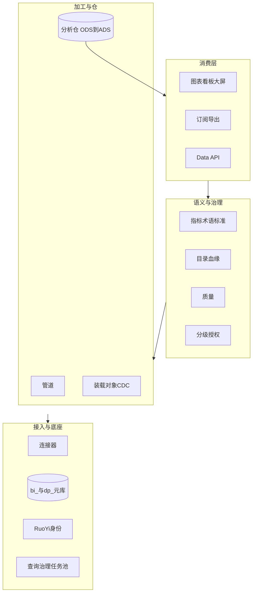

| 存储 | 职责 | 禁止 |
|---|---|---|
| 平台元库 | `bi_*` / `dp_*` 配置、运行元信息、审计 | 业务明细当数仓 |
| 业务源库 | OLTP/OLAP 只读或受控抽取 | 默认写回生产业务库 |
| 分析仓 | `wanfo_wh_{ods,dwd,dws,ads}` 物化 | 与元库混用 |

### 1.3 表前缀

| 前缀 | 含义 |
|---|---|
| `bi_*` | BI 消费事实（数据源、数据集、图表、看板、订阅等） |
| `dp_*` | 平台控制面（目录、管道、装载、质量、API、任务泳道等） |

目录资产通过 URN / 源资源 ID **引用** `bi_*`，不复制第二份图表/数据集定义。

### 1.4 身份与授权底座

1. RuoYi 登录 + 功能权限 `bi:*`  
2. 资源级授权（`bi_resource` / `bi_resource_grant` 等）：dataset、pipeline、datasource…  
3. 浏览器不可信：范围与脱敏在服务端重算  

### 1.5 关键实现入口

| 平面 | 部署 |
|---|---|
| 网关 / 认证 / 系统 | `8080` / `9200` / `9201` |
| BI+平台 | `9206` → `ruoyi-modules-bi.jar` |
| 前端壳 | `/bi-admin/*`（`BiWorkspaceLayout`：分析 / 数据中心双域 + 分组侧栏；`workspaceEditor` 全屏；`data-bi-theme`=`restrained`/`saas`/`ops`，工作台切换，`localStorage.bi-ui-theme`） |

### 1.6 延伸阅读

- [PRODUCT-POSITIONING-AND-FOUNDATION.md](PRODUCT-POSITIONING-AND-FOUNDATION.md)  
- [DATA-PLATFORM-ARCHITECTURE.md](DATA-PLATFORM-ARCHITECTURE.md)  
- [QUERY-GOVERNANCE.md](QUERY-GOVERNANCE.md)

---

## 2. 数据源与连接器

**章首摘要**：登记 JDBC/API/文件源，凭据加密存放；快照与刷新服务 API/文件类源；连接器能力表决定能否入仓/Parquet 等。

### 2.1 定位与边界

- **是**：连接登记、测连、建模 schema 范围、快照导入  
- **不是**：任意远程任意协议无白名单；明文回显密码  

### 2.2 业务主路径

1. 管理员在「数据源」创建连接（类型、URL、schema）  
2. 测连成功后启用（`status='0'`）  
3. 可选：API/文件导入快照；登记刷新计划  
4. 下游数据集 / 扫描 / 装载引用 `datasourceId`  

### 2.3 数据流转

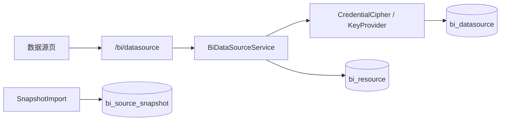

### 2.4 核心表

| 表 | 用途 |
|---|---|
| `bi_datasource` | 连接定义；密码为信封密文（可 `encgv:{version}:`） |
| `bi_source_snapshot` | API/文件快照版本 |
| `bi_source_refresh` | 快照刷新租约与状态 |
| `dp_credential_key_meta` / `dp_credential_key_rotation` | 密钥环与轮换审计（V55） |

### 2.5 关键实现

| 层 | 路径 |
|---|---|
| Service | `BiDataSourceService`、`SnapshotImportService`、`SourceRefreshService`、`CredentialKeyService` |
| API | `/bi/datasource`、`/bi/datasource/import`、`/bi/datasource/credentials/*` |
| 前端 | `/bi-admin/datasource` → `views/bi/datasource/index.vue` |

### 2.6 门禁与失败语义

- 资源 `datasource` view/edit/model  
- 测连失败不写业务库；凭据永不回显明文  
- KMS：默认本地密钥环；`EXTERNAL_KMS_STUB` 失败闭合  

### 2.7 已知边界

- 云 KMS 真适配仍 backlog  
- 连接器能力以代码注册为准（见 DATASOURCE-CONNECTORS）  

### 2.8 延伸阅读

- [DATASOURCE-CONNECTORS.md](DATASOURCE-CONNECTORS.md)

---

## 3. 数据集与查询

**章首摘要**：数据集是分析与管道的统一取数入口；交互预览 ≤100 行；管道生产走 `boundedExtract`；在线查询经 Calcite + 查询治理。

### 3.1 定位与边界

- **是**：表/SQL/关联模型数据集、字段、行列策略、缓存  
- **不是**：无限全表导出当默认查询；绕过策略的「调试 SQL」  

### 3.2 业务主路径

1. 基于数据源登记数据集与字段  
2. 配置策略（脱敏/行范围）  
3. 预览 / 图表查询 / 管道 SOURCE 节点引用  
4. （可选）物化、缓存  

### 3.3 数据流转

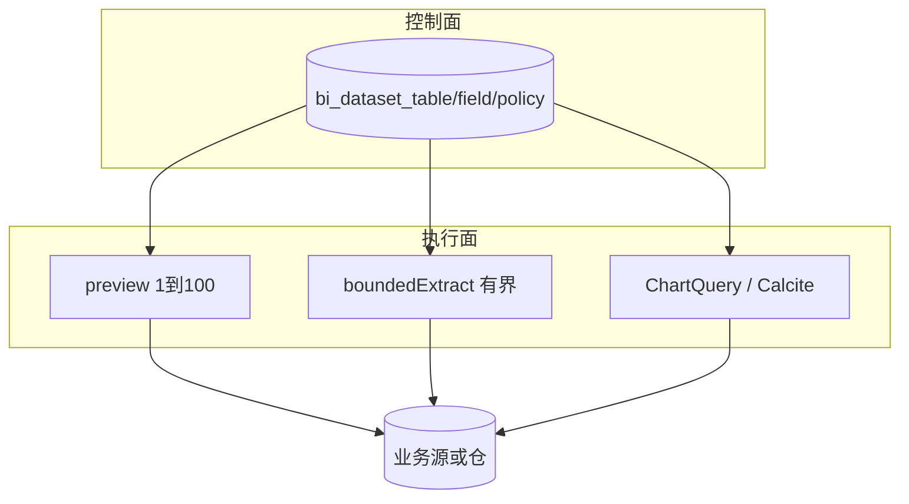

| 入口 | 方法 | 行数上限 |
|---|---|---|
| UI 预览 / 样本质量 | `DatasetService.preview` | 1～100 |
| 管道生产 SOURCE | `DatasetService.boundedExtract` | 至 Publisher `MAX_BATCH_ROWS`（受 `bi.pipeline.production-max-rows` 再截断） |
| 图表查询 | `ChartQueryService` + 查询治理 | 超时/并发/取消 |

### 3.4 核心表

| 表 | 用途 |
|---|---|
| `bi_dataset_table` | 数据集定义（type: table/sql…，`model_json`） |
| `bi_dataset_field` | 字段与源映射 |
| `bi_dataset_group` | 分组 |
| `bi_dataset_policy` | 数据策略绑定 |
| `bi_dataset_quality_rule` | 遗留单行 JSON 规则（平台质量见第 8 章） |

### 3.5 关键实现

| 层 | 路径 |
|---|---|
| Service | `DatasetService`、`DatasetModelService`、`ChartQueryService` |
| API | `/bi/dataset`、`/bi/query*` |
| 前端 | `/bi-admin/dataset`、`/bi-admin/query-monitor` |

### 3.6 门禁与失败语义

- `dataset` view + query  
- `JdbcSourceScope.limit` 硬顶与 Publisher 对齐；**预览**仍先由 `preview` 卡 100  
- 失败抛业务异常，不静默空成功  

### 3.7 已知边界

- 生产抽取仍是「有界内存批」，不是流式全表 ETL  
- SQL 型数据集需管理员能力  
- 历史关联数据集的 `union_sql` 可能仍是 MySQL 反引号 + 物理库名；图表/指标 Calcite 查询前会经 `DatasetQueryBaseBuilder.forCalcite` 归一为双引号 + `schema_name` 别名。新写入的关联 SQL 已按 Calcite 逻辑标识符生成。  

### 3.8 延伸阅读

- [DATA-PIPELINE-MODEL.md](DATA-PIPELINE-MODEL.md)（SOURCE 取数约定）  
- [QUERY-GOVERNANCE.md](QUERY-GOVERNANCE.md)

---

## 4. 元数据采集与资产目录

**章首摘要**：JDBC 扫描形成 `dp_asset` 版本快照；目录不复制 BI 事实；变更事件驱动影响分析。

### 4.1 定位与边界

- **是**：库表字段资产、扫描运行、版本、审计  
- **不是**：实时同步所有源库 DDL 的完整 CDC 元数据总线  

### 4.2 业务主路径

1. 为数据源配置扫描定义（范围 JSON）  
2. 手动或定时触发 `METADATA_SCAN`  
3. 结果 upsert 资产与版本；差异写结构变更事件  
4. 目录页检索 / 详情 / 影响包  

### 4.3 数据流转

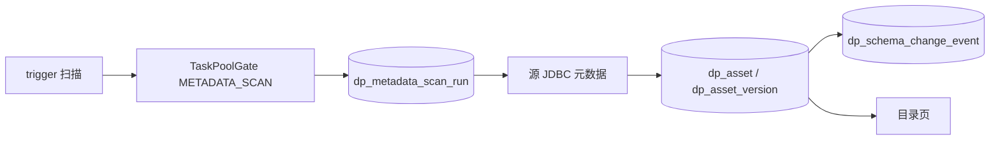

### 4.4 核心表

| 表 | 用途 / 状态 |
|---|---|
| `dp_metadata_scan` | 扫描配置；`status='0'` 启用 |
| `dp_metadata_scan_run` | `PENDING`→`RUNNING`→成功/失败 |
| `dp_asset` | 资产主档；`ACTIVE`/`STALE` |
| `dp_asset_version` | 结构快照 |
| `dp_catalog_audit` | 目录域操作审计 |

### 4.5 关键实现

| 层 | 路径 |
|---|---|
| Service | `MetadataScanService`、`CatalogAssetService`、`CatalogService` |
| API | `/bi/metadata-scans`、`/bi/catalog/assets`、`/bi/catalog` |
| 前端 | `/bi-admin/catalog` |

### 4.6 门禁与失败语义

- `bi:datasource:model` + 资源 edit/view  
- 同数据源同时仅一活跃扫描  
- 泳道暂停：提交拒绝「任务分池已暂停：METADATA_SCAN」  
- 调度触发遇暂停：跳过本轮  

### 4.7 已知边界

- 扫描表/列有上限（服务内常量）  
- 跨引擎完备依赖仍 backlog  

### 4.8 延伸阅读

- [DATA-PLATFORM-SCHEMA-INVENTORY.md](DATA-PLATFORM-SCHEMA-INVENTORY.md)（早期盘点，表已演进至 V62）

---

## 5. 数仓装载

**章首摘要**：源表 → 暂存 → 校验 → 原子晋升到目标层；支持 REPLACE/MERGE（引擎分发）；检查点与对账。

### 5.1 定位与边界

- **是**：JDBC 源到仓的受控装载、retail 模型物化、行范围映射  
- **不是**：开放 SQL 写仓；无界全表无超时  

### 5.2 业务主路径

1. 选择源/目标数据源、表、模式（FULL/INCREMENTAL）、层  
2. 提交装载 → `WAREHOUSE_LOAD` 泳道门禁  
3. Worker 执行 staging → promote  
4. 查看运行、检查点、对账  

### 5.3 数据流转

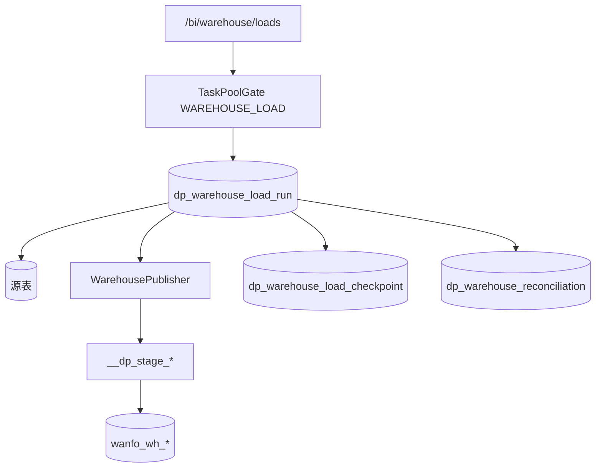

### 5.4 核心表

| 表 | 用途 / 状态 |
|---|---|
| `dp_warehouse_load_run` | `PENDING`→`RUNNING`→`SUCCEEDED`/`FAILED`/`INTERRUPTED`；含 `promote_status`、请求快照 |
| `dp_warehouse_load_checkpoint` | 增量水位/分区进度 |
| `dp_warehouse_reconciliation` | 对账；`PREPARED`→`PASS` |
| `dp_warehouse_table_model` | 表模型登记（V46） |

### 5.5 关键实现

| 层 | 路径 |
|---|---|
| Service | `WarehouseLoadService`、`WarehousePublisher`、`ClickHouseBatchPublisher` / `MysqlProtocolBatchPublisher` |
| API | `/bi/warehouse/loads`、`/models`、`/table-models`、`/scopes`、`/audit` |
| 前端 | `/bi-admin/warehouse` |

### 5.6 门禁与失败语义

- 目标必须是受控仓逻辑层  
- 失败保留旧可见表（交换语义）；暂存可清理  
- 泳道暂停/软并发  

### 5.7 已知边界

- 多副本 UNIQUE upsert 等仍加深项  
- 默认引擎全局配置 backlog  

### 5.8 延伸阅读

- [WAREHOUSE-LOAD-MVP-GUIDE.md](WAREHOUSE-LOAD-MVP-GUIDE.md)  
- [DATA-WAREHOUSE-ENGINE-ADR.md](DATA-WAREHOUSE-ENGINE-ADR.md)  
- [DATA-WAREHOUSE-PHYSICAL-PLAN.md](DATA-WAREHOUSE-PHYSICAL-PLAN.md)

---

## 6. 对象入仓与 CDC

**章首摘要**：对象存储 CSV/Parquet 有界入仓；CDC 不抓 binlog，只调度外部 staging → 装载。

### 6.1 对象入仓

#### 定位

有界对象文件解析（CSV/Parquet，体积/行数上限）写入仓表。

#### 流转

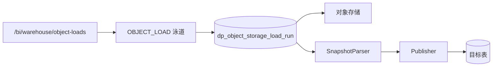

| 表 | 状态 |
|---|---|
| `dp_object_storage_load_run` | `PENDING`→`RUNNING`→`SUCCEEDED`/`FAILED` |

| 实现 | 路径 |
|---|---|
| Service | `ObjectStorageLoadService` |
| 前端 | `/bi-admin/warehouse` |

**边界**：ORC、>5MB 流式、深层嵌套无限展开仍 backlog。

### 6.2 CDC 编排

#### 定位

平台编排 Debezium（等）staging 表的周期 FULL/INCREMENTAL 装载，**不自建采集内核**。

#### 流转

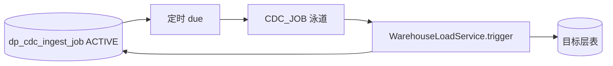

| 表 | 要点 |
|---|---|
| `dp_cdc_ingest_job` | `ACTIVE`/`PAUSED`；`last_watermark`、`interval_minutes` |
| 关联 | 装载 run 的 `trace_id` 形如 `cdc-%` |

| 实现 | 路径 |
|---|---|
| Service | `CdcIngestService` |
| API | `/bi/warehouse/cdc-jobs` |

**门禁**：泳道暂停时调度**跳过并打日志**，不把暂停记为作业失败。  
**边界**：真实 Debezium 拓扑与多表映射由外部保证。

### 6.3 延伸阅读

- [S3-BACKLOG.md](S3-BACKLOG.md) S3-07 / 对象加深说明  

---

## 7. 数据加工管道

**章首摘要**：版本化 DAG；预览只读样本；生产有界抽取后经统一 Publisher 写 `pipe_*`；支持 REPLACE/APPEND；提交受 PIPELINE 泳道约束。

### 7.1 定位与边界

- **是**：数据集上的类型化加工链（关联/过滤/映射/质量门禁/发布）  
- **不是**：通用分布式 ETL IDE、任意 SQL 节点、无限行  

### 7.2 业务主路径

1. 创建流程 → 草稿修订编排节点与边  
2. 静态校验保存 → 发布（生效指针）  
3. 预览运行（不写仓）或生产运行（指定目标仓数据源）  
4. 可选调度、回滚草稿、差异对比  

### 7.3 数据流转

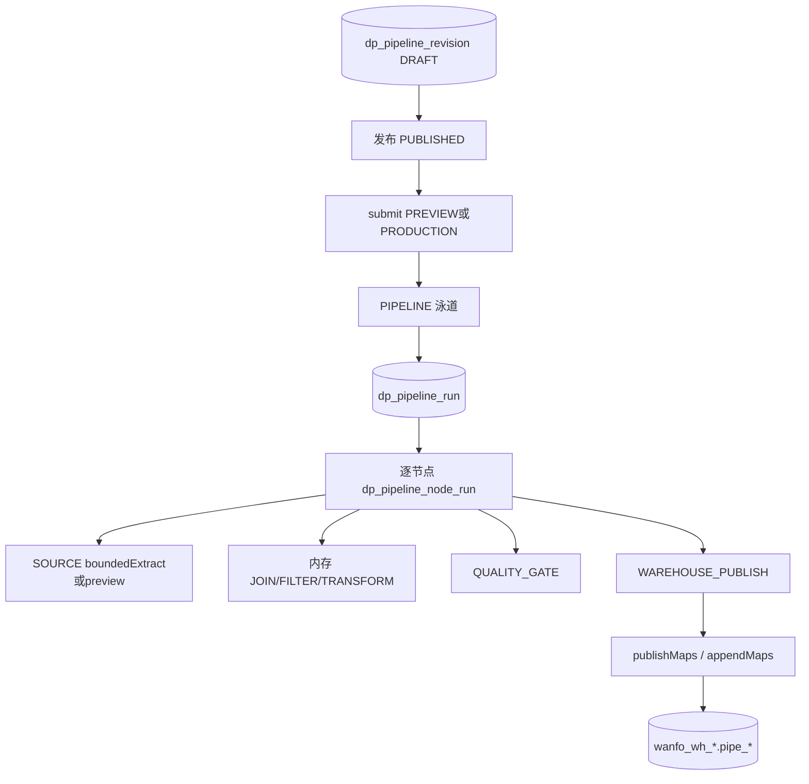

节点类型：`SOURCE_DATASET`、`JOIN`、`FILTER`、`TRANSFORM`、`QUALITY_GATE`、`WAREHOUSE_PUBLISH`。

`writeMode`：生产 Maps 支持 **REPLACE**（交换/改名）、**APPEND**（已存在则 `INSERT…SELECT`）；**UPSERT** 仅定义层占位，运行拒绝。

### 7.4 核心表

| 表 | 用途 / 状态 |
|---|---|
| `dp_pipeline` | 流程头；当前修订指针 |
| `dp_pipeline_revision` | `DRAFT`/`PUBLISHED`；`lock_version`；定义哈希 |
| `dp_pipeline_node` / `dp_pipeline_edge` | DAG |
| `dp_pipeline_publish_history` | 发布/回滚史 |
| `dp_pipeline_run` / `dp_pipeline_node_run` | 运行与节点态 |
| `dp_pipeline_schedule` | 生产调度 |

运行态：`PENDING`→`RUNNING`→`SUCCEEDED`/`FAILED`/`CANCELLED`/`TIMED_OUT`；节点另有 `SKIPPED`。

### 7.5 关键实现

| 层 | 路径 |
|---|---|
| Service | `PipelineDefinitionService`、`PipelineRunService`、`PipelineScheduleService` |
| API | `/bi/pipeline` |
| 前端 | `/bi-admin/pipeline`（Vue Flow 画布） |

### 7.6 门禁与失败语义

- 功能 `bi:pipeline:*` + 资源 pipeline  
- 生产：`assertLaneRunnable("PIPELINE")`；目标仓 schema 约束；字段标准 enforce 门禁  
- 截断样本拒绝写仓；失败不交换目标表  
- 每流程同时仅一活跃运行；幂等 `requestKey`  

### 7.7 已知边界

- 单实例有界执行；非抢占式分布式调度  
- 取数仍受数据集/驱动能力限制  

### 7.8 延伸阅读

- [DATA-PIPELINE-MODEL.md](DATA-PIPELINE-MODEL.md)  
- [PLATFORM-EXTENSION-ROADMAP.md](PLATFORM-EXTENSION-ROADMAP.md)

---

## 8. 数据质量

**章首摘要**：规则集版本化发布；任务绑定已发布版本；运行写结果与工单；可挂管道 QUALITY_GATE；提交受 QUALITY 泳道约束。

### 8.1 定位与边界

- **是**：数据集规则版本、调度任务、问题闭环、告警去重  
- **不是**：跨仓全局质量中台全量规则市场  

### 8.2 业务主路径

1. 草稿规则集 → 发布  
2. 创建任务（FULL/SAMPLE、超时、重试、调度）  
3. 手动/定时触发 → 运行 → 结果与 Issue  
4. 认领 / 修复待验 / 关闭  

### 8.3 数据流转

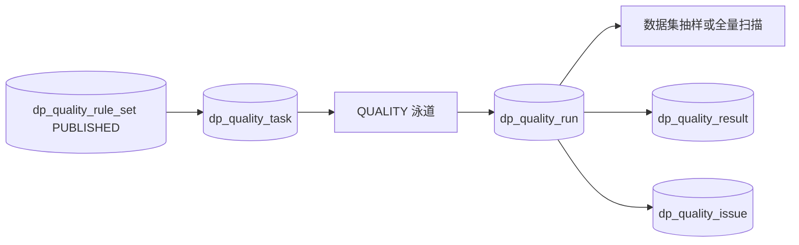

### 8.4 核心表

| 表 | 状态要点 |
|---|---|
| `dp_quality_rule_set` / `dp_quality_rule` | `DRAFT`/`PUBLISHED` |
| `dp_quality_task` | `ENABLED`/`PAUSED` |
| `dp_quality_run` | `QUEUED`→`RUNNING`→终态 |
| `dp_quality_result` | 单规则结果 |
| `dp_quality_issue` / `_history` | `OPEN`→`CLAIMED`→…→`RESOLVED` |
| `dp_quality_alert_*` | 告警去重与日志（V50） |

### 8.5 关键实现

| 层 | 路径 |
|---|---|
| Service | `QualityRuleVersionService`、`QualityTaskService`、`QualityAlertService` |
| API | `/bi/dataset/{id}/quality/*`、`/bi/dataset/quality/tasks/{id}/run` |
| 前端 | 数据集页内嵌（无独立顶级路由） |

### 8.6 门禁与失败语义

- 未发布规则集不可跑任务  
- 泳道暂停拒绝 trigger；调度失败记 warn  
- 管道内 QUALITY_GATE 可阻断下游发布  

### 8.7 已知边界

- 样本扫描 ≠ 全量证明  
- 跨域质量编排 backlog  

### 8.8 延伸阅读

- [DATA-QUALITY-VERSIONED-MODEL.md](DATA-QUALITY-VERSIONED-MODEL.md)

---

## 9. 血缘与结构变更

**章首摘要**：血缘边带置信与修订；扫描变更 → 影响包 / change-gate → 可选迁移计划；禁止伪造高置信边。

### 9.1 定位与边界

- **是**：资产间依赖、变更影响、受控迁移步骤  
- **不是**：自动跨引擎完美解析所有 SQL  

### 9.2 业务主路径

1. 采集/重建血缘边  
2. 结构变更事件 → 查看影响包（含脱敏无权消费者）  
3. change-gate 评估；必要时 `overrideBlocking` 审计放行  
4. 迁移计划审批执行 / 回滚修订  

### 9.3 数据流转

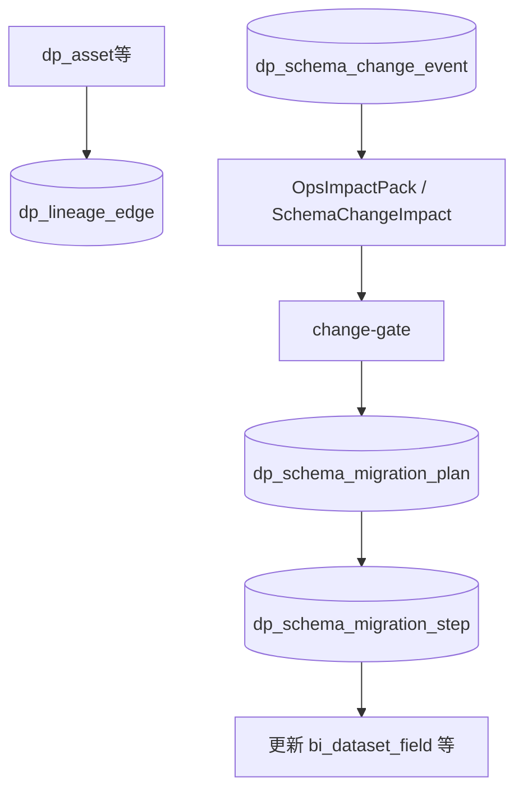

### 9.4 核心表

| 表 | 状态要点 |
|---|---|
| `dp_lineage_edge` / `_revision` | `ACTIVE`/`STALE`/`REVOKED` |
| `dp_schema_change_event` | 变更事实 |
| `dp_schema_migration_plan` / `_step` / `_revision` | `DRAFT`→`APPROVED`→`EXECUTING`/`EXECUTED`/`FAILED`/`ROLLED_BACK` |

### 9.5 关键实现

| 层 | 路径 |
|---|---|
| Service | `Lineage*Service`、`SchemaChangeImpactService`、`SchemaMigrationPlanService`、`OpsImpactPackService` |
| API | `/bi/catalog/lineage`、`/bi/catalog/assets/{id}/impact-pack`、`…/changes`、迁移相关 |
| 前端 | `/bi-admin/lineage`、目录页 |

### 9.6 门禁与失败语义

- 无权消费者：`[无权查看]` + `redactedConsumerCount`  
- 默认阻断高风险迁移；override 记审计  
- 不完整解析标 incomplete，不装作完整  

### 9.7 已知边界

- 自动建变更单、独立 override 审批流 backlog  

### 9.8 延伸阅读

- [DATA-LINEAGE-MODEL.md](DATA-LINEAGE-MODEL.md)  
- [SCHEMA-CHANGE-IMPACT.md](SCHEMA-CHANGE-IMPACT.md)

---

## 10. 指标 / 术语 / 字段标准

**章首摘要**：标准指标三件套（原子 / 派生 / 复合），**定义与查询分离**；发布冻结供 Data API；术语与字段标准挂目录/绑定；指标集与发布申请走 `dp_*`。

### 10.1 定位与边界

- **是**：口径定义（业务定义 / 粒度 / 单位 / 时区 / 负责人）、允许维度白名单、弱绑定术语、落标检查与 enforce 门禁  
- **不是**：独立指标中台 / Collibra 级政策引擎；不是「冻结整份 QueryModel 结果表」  

### 10.2 业务主路径

1. 定义原子/派生/复合指标 → 发布冻结 → 运行时带维度取数 / Data API 引用  
2. 术语认证；字段标准 CRUD 与 COLUMN/TABLE 绑定  
3. 合规只读 / 样本校验 / 在线 JDBC 抽样 / 管道发布门禁  

### 10.3 数据流转

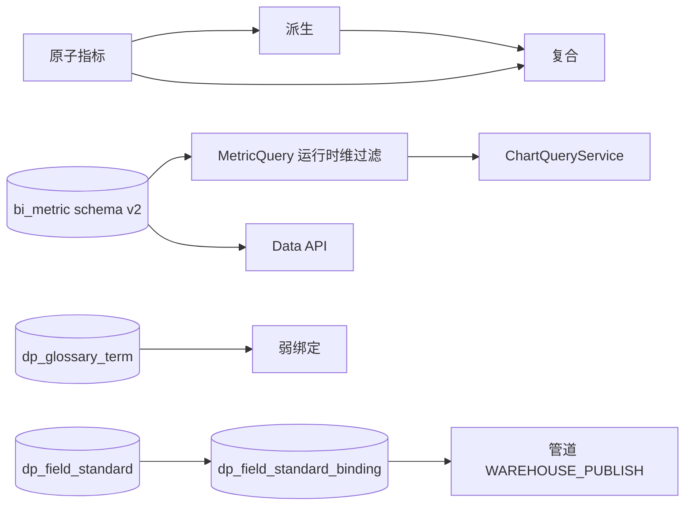

### 10.4 核心表

| 表 | 用途 |
|---|---|
| `bi_metric` / `bi_metric_history` / `bi_metric_usage` | 指标定义（`kind`: atomic\|derived\|composite）、史、引用 |
| `dp_metric_set` / `_member` / `dp_metric_publish_request` | 指标集与发布申请（V52） |
| `dp_glossary_term` | 术语 |
| `dp_field_standard` / `_binding` | 标准与绑定；`enforce_gate` |

### 10.5 关键实现

| API | 前端 |
|---|---|
| `/bi/metric`（preview/data 可带 `MetricQueryRequest`）、`/bi/metric-sets`、`/bi/glossary/terms`、`/bi/field-standards` | `/bi-admin/metric`、`metric-set`、`glossary`、`field-standard` |

编译：`MetricQueryCompiler` 将定义 + 请求编译为 `QueryModel`。派生在同库一次查询两度量后按行求表达式；复合仅标量。

### 10.6 门禁与失败语义

- 发布指标需权限与口径字段；enforce 标准不满足则管道发布失败  
- 运行时维度必须 ⊆ `allowedDimensions`；复合禁止运行时维度  
- 在线抽样标识符白名单，防注入  
- V64 **干净切换**：清空旧 scalar/table 指标及 Data API 绑定，不自动迁移  

### 10.7 已知边界

- 跨数据集带维度的派生/复合、独立 Measure/Dimension 实体层、图表强制绑指标：backlog  
- 跨域标准分层、批量绑定审批 backlog  

---

## 11. 分级脱敏与授权申请

**章首摘要**：敏感级别挂资产；查询/导出/API 方向一致强制；访问申请审批后写资源授权并可过期。

### 11.1 定位与边界

- **是**：分类分级、申请开通、到期  
- **不是**：单元格级动态策略引擎全量  

### 11.2 流转

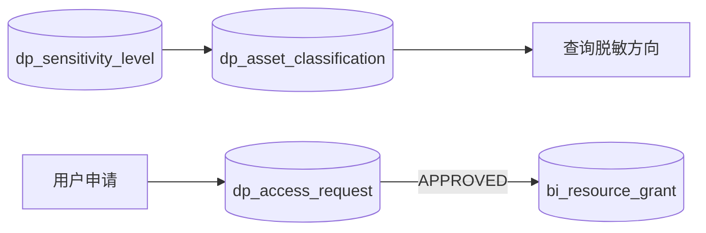

### 11.3 核心表

| 表 | 状态 |
|---|---|
| `dp_sensitivity_level` | 级别字典 |
| `dp_asset_classification` | 资产分类 |
| `dp_access_request` | `PENDING`→`APPROVED`/`REJECTED`；可 `EXPIRED` |

### 11.4 实现

- Service：`ClassificationService`、`AccessRequestService`  
- API：`/bi/catalog/classification`、`/bi/access-requests`  
- 前端：目录分类 + `/bi-admin/access-requests`  

### 11.5 延伸阅读

- [DATA-CHANGE-AND-METRIC-GOVERNANCE.md](DATA-CHANGE-AND-METRIC-GOVERNANCE.md)（相关治理叙述）

---

## 12. Data API

**章首摘要**：指标驱动的受控查询 API；版本族、契约门禁、调用方、配额、金丝雀、样本回放。

### 12.1 定位与边界

- **是**：Key 鉴权、配额、版本生命周期、契约兼容检查  
- **不是**：任意 SQL 开放网关  

### 12.2 业务主路径

1. 绑定已发布指标创建 API 草稿 → 契约校验 → 发布  
2. 管理 Key / 调用方组织  
3. 外部调用记账；可 deprecate / next-version / 金丝雀  
4. 样本落库与 sample-replay  

### 12.3 数据流转

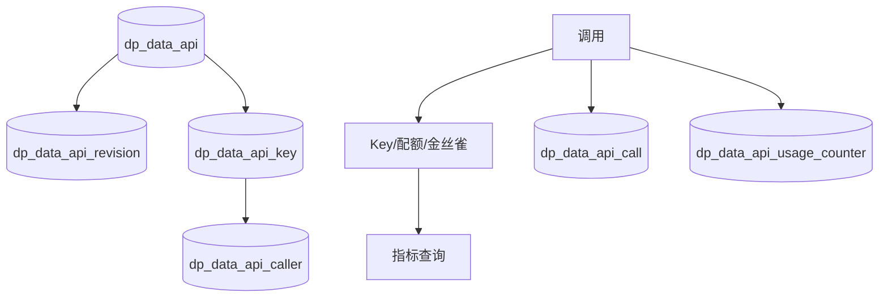

### 12.4 核心表

| 表 | 要点 |
|---|---|
| `dp_data_api` | `DRAFT`/`ACTIVE`/`DEPRECATED`/`DISABLED`；`family_code`；sunset |
| `dp_data_api_revision` | 发布修订；契约/样本 JSON |
| `dp_data_api_key` | `ACTIVE`/`REVOKED`；可绑 caller |
| `dp_data_api_caller` | 调用方名录 |
| `dp_data_api_call` / `_usage_counter` | 调用与配额计数 |

### 12.5 关键实现

| 层 | 路径 |
|---|---|
| Service | `DataApiService` |
| API | `/bi/data-apis`、`/callers`、门户与契约/回放接口 |
| 前端 | `/bi-admin/data-api` |

### 12.6 门禁与失败语义

- 发布阻断相对继任的删列/改类型（契约）  
- 配额/全局日配额耗尽拒绝  
- 密钥仅创建时展示  

### 12.7 已知边界

- 按调用方加权金丝雀、完整 payload 审计回放 backlog  

### 12.8 延伸阅读

- [DATA-SERVICE-CATALOG.md](DATA-SERVICE-CATALOG.md)  
- [S3-ACCEPTANCE-RECORD.md](S3-ACCEPTANCE-RECORD.md)

---

## 13. 任务中心与泳道

**章首摘要**：只读聚合各域运行事实，不建第二套任务状态表；`dp_task_pool_lane` 做暂停与软并发。

### 13.1 定位与边界

- **是**：统一运维视图、分池门禁  
- **不是**：抢占式多租户公平调度器  

### 13.2 流转

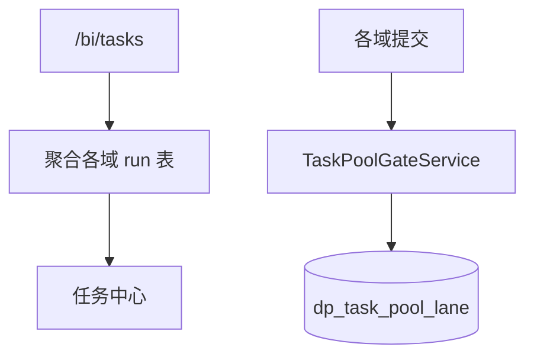

### 13.3 泳道与提交入口

| 泳道 | 提交入口（assert） |
|---|---|
| `WAREHOUSE_LOAD` | `WarehouseLoadService` |
| `OBJECT_LOAD` | `ObjectStorageLoadService` |
| `PIPELINE` | `PipelineRunService.submit` |
| `CDC_JOB` | `CdcIngestService.runOnce` |
| `QUALITY` | `QualityTaskService.trigger` / 调度入队 |
| `METADATA_SCAN` | `MetadataScanService.trigger` |

聚合类型另含 `EXPORT`、`SUBSCRIPTION*`（来自 `bi_export_job` 等，未必有同名泳道行）。

### 13.4 核心表

| 表 | 字段要点 |
|---|---|
| `dp_task_pool_lane` | `lane`、`paused`、`max_concurrent`（0=不限） |

### 13.5 实现

- `TaskCenterService`、`TaskPoolGateService`  
- `/bi/tasks`、`/bi/tasks/lanes`  
- `/bi-admin/task-center`  

### 13.6 延伸阅读

- [TASK-CENTER-MVP.md](TASK-CENTER-MVP.md)  
- [S3-BACKLOG.md](S3-BACKLOG.md) S3-01  

---

## 14. 审计 / 备份演练 / 凭据

**章首摘要**：目录审计可归档；备份演练登记 RPO/RTO 证据；凭据版本化信封可轮换。

### 14.1 审计

| 表 | 用途 |
|---|---|
| `dp_catalog_audit` | 操作审计（无密钥/行数据正文） |
| `dp_audit_archive` / `dp_audit_retention_policy` | 归档与保留 |

Service：`CatalogAuditService`；API：`/bi/catalog/audit`。

### 14.2 备份演练

| 表 | 用途 |
|---|---|
| `dp_backup_drill` | 演练记录 |
| `dp_backup_artifact_watch` | dump 文件监视登记 |

Service：`BackupDrillService`；API：`/bi/ops/backup-drills`；前端：`/bi-admin/backup-drills`。  
延伸：[BACKUP-RESTORE-DRILL.md](BACKUP-RESTORE-DRILL.md)

### 14.3 凭据

见第 2 章；`CredentialKeyService` + `/bi/datasource/credentials/*`。

### 14.4 已知边界

- 跨机房复制、仓引擎官方备份联调、真云 KMS backlog  

---

## 15. BI 消费侧

**章首摘要**：图表/看板/大屏/订阅/导出消费数据集与指标；权限与脱敏走同一底座；细节以 BI 专题为准，此处只钉主表与和平台的衔接。

### 15.1 定位与边界

- **是**：分析消费与投递  
- **不是**：本文展开全部图表视觉/模板市场设计（见专题）  

### 15.2 主路径与衔接

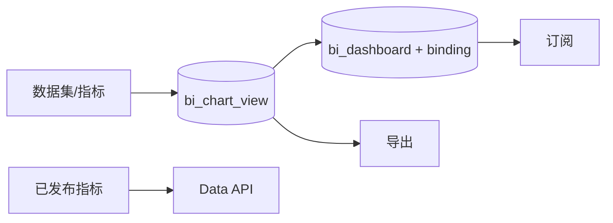

### 15.3 核心表（摘要）

| 表 | 用途 |
|---|---|
| `bi_chart_view` | 图表定义 |
| `bi_dashboard` / `bi_dashboard_binding` / `bi_dashboard_share` | 看板与分享 |
| `bi_report_subscription` / `_audit` / `bi_report_notification` | 订阅与通知 |
| `bi_export_job` | 导出作业 |
| `bi_screen_template` 等 | 大屏/模板 |

### 15.4 实现入口

| 能力 | API | 前端 |
|---|---|---|
| 图表 | `/bi/chart` | `/bi-admin/chart`、`chart-workspace` |
| 看板 | `/bi/dashboard` | `/bi-admin/dashboard*` |
| 订阅 | `/bi/subscription` | `/bi-admin/subscription` |
| 导出 | `/bi/export` | `/bi-admin/export` |

### 15.5 延伸阅读

- [BI-WORKFLOW-ENHANCEMENTS.md](BI-WORKFLOW-ENHANCEMENTS.md)  
- [CHART-OPTIMIZATION-ROADMAP.md](CHART-OPTIMIZATION-ROADMAP.md)

---

## 16. 附录

### 16.1 表 → 章节速查（平台主表）

| 表 / 表族 | 章 |
|---|---|
| `bi_datasource`、`bi_source_*`、`dp_credential_key_*` | 2 |
| `bi_dataset_*` | 3 |
| `dp_asset*`、`dp_metadata_scan*` | 4 |
| `dp_warehouse_load_*`、`dp_warehouse_reconciliation` | 5 |
| `dp_object_storage_load_run`、`dp_cdc_ingest_job` | 6 |
| `dp_pipeline*` | 7 |
| `dp_quality_*` | 8 |
| `dp_lineage_*`、`dp_schema_*` | 9 |
| `bi_metric*`、`dp_glossary_*`、`dp_field_standard*`、`dp_metric_set*` | 10 |
| `dp_sensitivity_*`、`dp_access_request` | 11 |
| `dp_data_api*` | 12 |
| `dp_task_pool_lane` | 13 |
| `dp_catalog_audit`、`dp_backup_*` | 14 |
| `bi_chart_*`、`bi_dashboard*`、`bi_export_*`、`bi_report_*` | 15 |

### 16.2 Flyway 能力地图（平台段摘要）

| 版本区间 | 能力 |
|---|---|
| V27–V28 | 目录资产、扫描、审计 |
| V29–V31 | 装载运行、检查点、对账 |
| V32–V33 | 版本化质量、工单史 |
| V34–V36 | 管道定义/运行/发布安全 |
| V37–V40 | 行范围、血缘、结构变更与迁移计划 |
| V41–V45 | Data API、审计归档、装载快照、管道调度、质量重试 |
| V46–V50 | 表模型/术语、对象入仓与 CDC、晋升契约、告警 |
| V51–V54 | 分级、指标集/申请、API sunset、字段标准 |
| V55–V56 | 凭据密钥环、备份演练 |
| V57–V62 | API 契约/调用方/族版本/金丝雀/样本；任务泳道与运维加深 |
| V63 | W7：泳道优先级/权重、标准域与批量绑定计划、调用方加权金丝雀与 call sample、变更单与 override ticket |
| V64 | 标准指标干净切换：原子/派生/复合（schema v2）；清空旧 scalar/table 指标及 Data API 绑定 |

完整 DDL 以 `Wanfo-Cloud/ruoyi-modules/ruoyi-bi/src/main/resources/db/migration/bi/` 为准。

### 16.3 前端 `/bi-admin` 信息架构与路由

**壳**：`BiWorkspaceLayout` 顶部分域切换 —— **分析**（看板/图表/指标/填报/订阅/导出）与 **数据中心**（资产/加工装载/语义开放/治理运维）；侧栏按组折叠展示，工作台两端共用；设计器类路由 `meta.workspaceEditor` 隐藏侧栏全屏。偏好键 `localStorage.bi-workspace-domain`。

| 路由 | 产品域 | 能力 |
|---|---|---|
| `/bi-admin/workbench` | 共用 | 今日待办 / 快速创建 / 最近编辑 |
| `/bi-admin/dashboard`、`chart`、`template` | 分析 | 看板与图表 |
| `/bi-admin/metric`、`metric-set`、`form`、`subscription`、`export` | 分析 | 指标 / 填报 / 交付 |
| `/bi-admin/catalog`、`datasource`、`dataset`、`lineage` | 数据中心 | 资产 |
| `/bi-admin/pipeline`、`warehouse`、`task-center` | 数据中心 | 加工与装载 |
| `/bi-admin/glossary`、`field-standard`、`data-api` | 数据中心 | 语义与开放 |
| `/bi-admin/access-requests`、`query-monitor`、`backup-drills` | 数据中心 | 治理与运维 |

部分列表页仍由 `sys_menu` 注册组件路径；常量路由兜底平台深化页（目录/加工/标准/备份等）。以运行库菜单 + 本表为准。

**外观主题**：工作台「外观设置」切换 `restrained` / `saas` / `ops`；壳根 `data-bi-theme`；设计见 `docs/superpowers/specs/2026-10-31-bi-ui-theme-design.md`。

### 16.4 变更日志（本文）

| 日期 | 说明 |
|---|---|
| 2026-10-31 | 初版：按功能域汇总实现原理；对齐 W5/W6（APPEND、泳道、boundedExtract） |
| 2026-10-31 | W7/V63：S3 加深收口（公平泳道、标准域/绑批、加权金丝雀、变更单、CLOUD_KMS_DEV、仓探测、对象流式入口、管道 UPSERT） |
| 2026-10-31 | 前端壳：分析/数据中心双域 + 分组导航；工作台今日待办；编辑器全屏 |
| 2026-10-31 | 前端：三套可切换 UI 主题（令牌 + 工作台外观设置；List 骨架分批） |
| 2026-11-01 | 指标：原子/派生/复合标准定义（schema v2）；定义与查询分离；V64 干净切换 |
| 2026-11-01 | 图表/指标查询：遗留 MySQL 反引号 `union_sql` 在 Calcite 前归一（forCalcite） |
| 2026-11-01 | 入口文档基线对齐 V64；README / 产品定位与本文导读同步 |
| 2026-11-02 | 增补商业价值后续清单链接：`COMMERCIAL-VALUE-BACKLOG.md`（待排期，不扩 S4+ 默认范围） |

---

**完。** 新功能上线时：更新对应章节 + 本附录变更日志一行即可。
